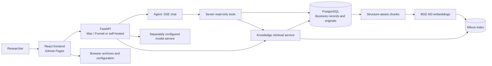

# Market Evidence Agent

[中文](README.md) | [English](README.en.md)

**Demo:** [Open the research workspace](https://wp1461772181-glitch.github.io/market-evidence-agent/) · **Repository:** [wp1461772181-glitch/market-evidence-agent](https://github.com/wp1461772181-glitch/market-evidence-agent)

Market Evidence Agent is a research workspace for individual US stock researchers. It brings saved market data, SEC filings, research materials, and versioned analyses together, with bounded Agent chat over saved evidence. Researchers can find leads in materials, inspect sources, save analyses, and review forecast versions and later revisions.

The product focuses on an inspectable research process, traceable evidence, and conclusions that can be revised when new material arrives. It does not promise accurate stock forecasts and is neither a trading system nor a live-quote service.

## Agent chat

- Full-page SSE chat streams status, tool calls, results, and answers, with readable badges for tool activity.
- On each turn, the model selects one of seven read-only Function Calling tools. The server runs that tool, then asks the model to synthesize an answer. Multiple tool calls are rejected. The Agent does not run an autonomous loop, browse the web, fetch SEC data online, or perform write operations.
- Answers support Markdown, tables, source citations, and quoted excerpts. Users can copy answers, navigate to questions, and inspect cited sources.
- Conversations and tool traces are stored server-side by identity, with guest and personal identities separated. Users can export a local JSON conversation archive as a backup.

| Tool | Purpose |
| --- | --- |
| `query_stock_prices` | Read saved daily OHLCV and fetch time; these are not live quotes. |
| `query_latest_forecast` | Read the current research forecast version, status, time, and summary for a stock. |
| `query_materials` | Search saved SEC filing excerpts and user uploads; it does not search FAQs. |
| `query_sec_filings` | Read the saved SEC filing inventory and fetched excerpts; it does not contact SEC. |
| `query_research_faq` | Search the approved research FAQ. |
| `query_material_analysis` | Read the latest saved AI analysis and its source link for a material. |
| `search_material_analysis` | Search saved AI analyses, which are derived materials. |

## Try it

1. Open the [online demo](https://wp1461772181-glitch.github.io/market-evidence-agent/). Visitors can browse; write operations require a personal identity.
2. In Model settings, enter a profile display name, endpoint, model ID, and your own model key. Run the connection test and save the profile. Select it in the chat composer to use it. See the [model profile and storage guide](docs/model-profile-storage.md).
3. Ask about an original quote in saved materials, or about supporting evidence, counter evidence, and key numbers in a saved AMD analysis. Then inspect the cited source.

Visitors do not receive administrator access, and the demo server does not provide shared model keys.

## Model settings and local conversation archives

- Choose a preset model or a custom HTTPS endpoint, then enter a model ID and display name. The UI supports connection checks, saved profile cards, and profile selection in the chat composer.
- Services that support model discovery can return up to five suggestions. The provider catalog includes DeepSeek, Kimi, MiniMax, Qwen, Zhipu, Doubao, Hunyuan, Baidu, SiliconFlow, OpenRouter, and custom endpoints. Discovery depends on the service.
- Browser credentials use OPFS/IndexedDB. A separately configured local server-file mode is also available for local deployments. The browser does not treat arbitrary plaintext project files as its credential store; this does not imply encryption at rest.
- Chat history does not store provider API keys. Automatic archiving depends on browser support, and the archive file must be selected again after reload. Archives are local conversation records, not an evidence store; see the [conversation archive guide](docs/chat-local-files.md).

## Research materials and retrieval

The material library manages approved FAQs, fetched SEC filing excerpts, and user-uploaded TXT, Markdown, and PDF files (without OCR). The backend provides upload/import, retrieval testing, and index status. PostgreSQL stores originals, chunks, jobs, and analysis versions; Milvus stores the vector index. BGE-M3 produces dense vectors. The online demo currently uses hybrid retrieval, fusing dense results and BM25 with RRF. `bge-reranker-v2-m3` reranking can be enabled through configuration.

Parsing retains document structure and table headers. Retrieval applies owner, stock, time, and version filters, and supports idempotent retries, reindexing, and citations to exact sources.

### Saved analyses become knowledge

Saved AI analyses can be added to knowledge retrieval in six groups: summary, facts, supporting inferences, counter inferences, key numbers, and uncertainties. Analyses retain versions, model information, and original quotes; indexed results follow public/private visibility and owner isolation. These are AI analyses derived from source material, not independently verified facts.

Public validation so far includes two saved AMD analyses that produced 66 chunks, followed by successful indexing, querying, and citation readbacks. This verifies the workflow; it does not mean all historical materials have been backfilled or every question will retrieve accurately. Conversation review and extraction are separate optional operations; the system does not automatically learn from every chat.

## Research workspace

- **Watchlist and overview:** Users can maintain a list of US stock symbols; seven example stocks are provided by default. Stock pages organize prices, materials, forecasts, and evaluation by symbol.
- **Prices and benchmark:** View saved OHLCV and SPY comparison candlesticks with data dates and fetch times. Historical snapshots can be read with time boundaries.
- **SEC filings:** Store filing inventories, source links, and fetched excerpts; scanning can be started from the materials workflow. The Agent only reads saved records and does not fetch online.
- **Material analysis:** Generate and cache AI analyses with versions, original quotes, and citation navigation. Reopening a saved analysis does not call a model again.
- **Research workflow:** Reusable material analyses can produce a ResearchBrief, which can then be evaluated by the experimental Jev three-class decision model as bullish, neutral, or bearish. Jev consumes a research brief; it does not generate one. Fixed targets and expiry assessments are retained with immutable versions.
- **Evaluation and run status:** Inspect expiry assessments, historical replay, background queues, and monitoring status. A four-strategy Recall@K/MRR evaluation harness exists; synthetic results do not represent production accuracy.
- **News leads:** News discovery is a separate saved-lead workflow, not live web retrieval by the chat Agent.

Jev forecasts retain the original probabilities. A local calibration pipeline uses matured observed samples and enables a candidate only after chronological holdout validation; historical calibration research is kept separate from live samples. Outputs remain experimental research results, not forward-validated investment success rates.

## Architecture

PostgreSQL stores business records, originals, chunks, jobs, and conversations; Milvus stores the retrieval index. Originals and vector indexes are updated separately, not as one atomic dual-write. Model services are configured separately from the business database. The public demo frontend is hosted on GitHub Pages; the backend runs on the maintainer's Mac and is exposed through Funnel, so availability depends on that host being online. Local self-hosting is also supported by the setup documentation.

## Current boundaries

The Agent reads saved records only. It does not trade, browse the web, retrieve live news or prices, or fetch SEC filings online. Evidence-sufficiency checks and controls for insufficient evidence are implemented, but provider failures may not degrade perfectly, and answers can still be wrong. Citations and evaluation tools help inspect the evidence chain; they do not prove every answer is fully faithful.

Forecasts, material analyses, and retrieval results require researcher review against original sources and timestamps. Forecast evaluation is meaningful only for matured samples with available outcomes; historical replay and synthetic retrieval metrics do not establish future performance. High-concurrency guarantees, end-to-end atomic writes, and autonomous Agent loops are outside current capability claims.

## Documentation

- [Local setup and deployment](docs/github-pages-local-backend.md)
- [Conversation archive files](docs/chat-local-files.md)
- [Model profiles and storage](docs/model-profile-storage.md) · [Model discovery](docs/model-discovery.md)
- [Knowledge retrieval](docs/knowledge-rag.md) · [Four-strategy evaluation report](docs/knowledge-rag-ch34-reports/four-strategy-evaluation.md)
- [Custom stock support](docs/custom-stock-support.md) · [Experimental forecast and learning limits](docs/jev-local-learning.md)

## Future direction

Possible next steps include improving workflow orchestration, reference resolution and contextual memory, web/news workflows callable by the Agent, and runtime observability. These remain future directions; they are not claims that multi-Agent autonomy or model fine-tuning is complete.
