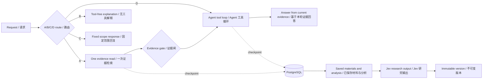

<div align="center">

# 📈 Market Evidence Agent

### 先找证据，再形成判断。  
### Evidence first. Decisions you can revisit.

**一个面向市场研究的双语 AI 工作台：把公开资料、已保存的数据与可追溯的研究判断连起来。**  
**A bilingual research workbench connecting public sources, saved data, and traceable market judgments.**

[🚀 试用演示 / Try the demo](https://wp1461772181-glitch.github.io/market-evidence-agent/) · [📦 Source repository](https://github.com/wp1461772181-glitch/market-evidence-agent) · [🧭 中文](#中文) · [🇬🇧 English](#english)

</div>

> **演示说明 / Demo note** — GitHub Pages 提供前端；数据与 API 依赖维护者侧的独立后端。后端环境会影响演示可用性。  
> GitHub Pages serves the frontend; data and API actions depend on a separate maintainer-hosted backend, which affects demo availability.

## 🧭 工作流 / Shared workflow



---

# 中文

<a id="中文"></a>

## 🌱 项目简介

Market Evidence Agent 是一个**金融市场证据研究与版本化判断原型**。你可以用自然语言查询已保存的行情、SEC 文件和研究材料，也可以单独进行公开网页研究。系统整理可核对的来源，汇总材料分析，并将实验性三分类判断绑定到明确的证据版本和固定目标。

它让研究过程更容易回看：**当时看到了什么、依据来自哪里、后来新增了什么、判断如何变化。**

## 💬 可以这样问

- “查一下 AAPL 最近保存的 SEC 文件有哪些？”
- “这份 10-K 对收入风险说了什么？请给我原文出处。”
- “搜索近期关于 NVIDIA 的产品新闻，并列出发布日期和来源。”
- “总结我保存的 MSFT 材料里，对现金流的不同说法。”
- “解释看跌、中性、看涨三类概率分别表示什么。”
- “把刚才找到的文件生成 AI 分析。”——会先显示操作确认卡。

公开网页研究是独立的只读能力，网页结果不会自动导入已保存材料；用户明确要求保存后，可由所有者确认入库。最近新闻检索会要求可解析的发布日期；显式时间跨度由 `days_back`（1–366 天）精确裁剪，未注明跨度的“最近”按近 7 天筛选。写操作会先显示操作与目标，等待确认。

## ✨ 能力一览

### 自然语言研究 Agent

请求通过**A 证据检索、B 无工具概念回答、C 固定范围回复、D Agent 工具循环**四类路径处理。A 路径先检索并校验证据，空结果仍可继续联网查找；D 路径直接进入工具循环。结构化模型调用决定路由与工具参数，没有基于公司名单或研究队列的硬编码路由。指代消解与分类是两个独立步骤；确认写入会冻结目标，并校验权限和重放。质量与发布状态见下方验收报告。

### 数据与网页研究

七种已保存数据读取工具覆盖价格历史、最新已保存预测、SEC 文件、材料、材料分析和研究 FAQ；`web_research` 是独立的第八种只读能力。公开网页发现使用 Tavily，也可读取用户提供的 HTTPS 页面，并限制请求大小、跳转次数与摘录长度。网页摘录可能不完整或过时，不会自动变成已保存或已核验材料。

### 确认写操作与对话上下文

Agent 可提出写操作：只有所有者确认冻结目标的卡片后才执行，令牌绑定当前对话、10 分钟有效并防止重复执行。游客的队列和页面动作仅作用于当前浏览器。网页可经确认保存为 `web_news`，检索时持续标注网页来源。对话上下文分三层：近期轮次保留原文，较早轮次部分压缩，更早内容以追加式摘要保留。默认历史预算为 **64 KB**，可通过 `AGENT_CONTEXT_BUDGET_KB` 配置（16–128 KB）。摘要是记忆而非证据，回答依据来自本轮工具结果。

### 可追溯分析与实验性判断

单份材料分析可汇总为 `ResearchBrief`，记录引用材料、来源版本与决策时点。预测版本不可变，并关联固定目标合同。Jev 输出看跌 / 中性 / 看涨三类概率，默认 `FORECAST_DECISION_MODE=research_only`。成熟度评估区分尚未到期和可评估目标；历史回放与校准研究不证明前向准确率，本地校准也不等于微调 Jev。

### 可选知识检索（RAG）

可选 BGE-M3 / Milvus 路径支持 dense、BM25、hybrid、RRF 和**可选 reranking**，并提供服务端范围约束与来源引用。基础 RAG 不要求 reranker 模型文件；启用额外能力前请看[知识库与 RAG 指南](https://github.com/wp1461772181-glitch/market-evidence-agent/blob/main/docs/knowledge-rag.md)。

## 🧭 流程图

上方共享流程图展示了读取与写入路径。公开网页研究不会自动入库；RAG 是可选检索路径。

## 🏗️ 技术栈与源码地图

| 部分 | 技术或入口 |
| --- | --- |
| 前端 | React 19、TypeScript、Vite；[应用入口](https://github.com/wp1461772181-glitch/market-evidence-agent/blob/main/frontend/src/App.tsx)、[Agent 面板](https://github.com/wp1461772181-glitch/market-evidence-agent/blob/main/frontend/src/AgentChatPanel.tsx) |
| API 与工作流 | Python 3.12、FastAPI、LangGraph；[工作流](https://github.com/wp1461772181-glitch/market-evidence-agent/blob/main/app/agent_workflow/graph.py)、[直接工具循环](https://github.com/wp1461772181-glitch/market-evidence-agent/blob/main/app/agent_workflow/direct.py)、[写操作](https://github.com/wp1461772181-glitch/market-evidence-agent/blob/main/app/agent_workflow/consent.py) |
| 对话上下文 | 三层记忆与预算；[预算展示组件](https://github.com/wp1461772181-glitch/market-evidence-agent/blob/main/frontend/src/ContextMeter.tsx) |
| 研究数据 | [保存数据工具](https://github.com/wp1461772181-glitch/market-evidence-agent/blob/main/app/agent_tools.py)、[网页研究](https://github.com/wp1461772181-glitch/market-evidence-agent/blob/main/app/agent_web_research.py)、[材料分析](https://github.com/wp1461772181-glitch/market-evidence-agent/blob/main/app/material_analysis.py)、[ResearchBrief](https://github.com/wp1461772181-glitch/market-evidence-agent/blob/main/app/research_brief.py) |
| 持久化与自动化 | PostgreSQL（含工作流检查点）；GitHub Actions 使用 PostgreSQL 16、Node.js 22；[CI 配置](https://github.com/wp1461772181-glitch/market-evidence-agent/blob/main/.github/workflows/ci.yml) |

## 🚀 本地开发（可选）

需要 Python **3.12**、Node.js **22**，以及已配置并初始化 PostgreSQL 的本地环境。基础 Python API 也以数据库已就绪为前提；迁移、worker 和 RAG 是额外设置。仓库根目录没有 `docker-compose.yml`。

```bash
git clone https://github.com/wp1461772181-glitch/market-evidence-agent.git
cd market-evidence-agent

# 仅在没有现有配置时，从模板创建 .env
[ -f .env ] || cp .env.example .env

python3.12 -m venv .venv
source .venv/bin/activate
python -m pip install -e '.[test]'

cd frontend
npm ci
cd ..
```

请先阅读[本地后端与部署说明](https://github.com/wp1461772181-glitch/market-evidence-agent/blob/main/docs/github-pages-local-backend.md)和[环境变量模板](https://github.com/wp1461772181-glitch/market-evidence-agent/blob/main/.env.example)，按本地功能准备数据库和模型服务；密钥不要提交到 Git。基础启动方式如下：

```bash
# Terminal 1: configured, initialized PostgreSQL must be available
source .venv/bin/activate
uvicorn app.main:app --reload

# Terminal 2
cd frontend
npm run dev
```

按 Vite 输出的本地地址打开前端。RAG 另需其依赖、Milvus、知识 schema 和索引；请参阅[RAG 指南](https://github.com/wp1461772181-glitch/market-evidence-agent/blob/main/docs/knowledge-rag.md)与[`requirements-rag.txt`](https://github.com/wp1461772181-glitch/market-evidence-agent/blob/main/requirements-rag.txt)。reranking 可选。

### 开发者检查（按需）

```bash
python -m pytest -q
cd frontend
npm run test:i18n
npm run build
```

## 📚 延伸阅读

- [对话上下文与预算](https://github.com/wp1461772181-glitch/market-evidence-agent/blob/main/docs/agent-context.md)
- [Jev 本地校准与成熟度边界](https://github.com/wp1461772181-glitch/market-evidence-agent/blob/main/docs/jev-local-learning.md)
- [自定义股票代码支持](https://github.com/wp1461772181-glitch/market-evidence-agent/blob/main/docs/custom-stock-support.md)
- [Agent 工作流设计说明](https://github.com/wp1461772181-glitch/market-evidence-agent/blob/main/docs/agent-research-v3-spec.md)
- [模型配置文件存储](https://github.com/wp1461772181-glitch/market-evidence-agent/blob/main/docs/model-profile-storage.md)

## ⚖️ 研究边界

- 这是持续演进的研究原型，不是投资建议、交易系统或收益承诺。
- 三分类输出是实验性判断；历史回放和本地校准不证明前向准确率。
- 结果受已保存数据、网页可读性和模型配置影响；摘录可能不完整，证据门控不能替代核对原文。
- 后端取决于维护者侧环境；RAG 需要额外服务与索引。

---

# English

<a id="english"></a>

## 🌱 What it is

Market Evidence Agent is a **market-research and versioned-judgment prototype**. Ask natural-language questions about saved price history, SEC filings, and research materials, or run public-web research as a separate read capability. It gathers source-backed results, can synthesize material analyses, and links experimental three-class judgments to a specific evidence version and fixed target.

The research trail stays easier to revisit: **what was available then, where a claim came from, what changed later, and how the judgment evolved.**

## 💬 Example prompts

- “Which AAPL SEC filings have been saved most recently?”
- “What does this 10-K say about revenue risks? Show the source.”
- “Search recent NVIDIA product news and include publication dates and sources.”
- “Compare saved MSFT materials that discuss cash flow.”
- “Explain what bearish, neutral, and bullish probabilities mean.”
- “What does this saved filing say about revenue risks?” — inspect a source-grounded answer and its citation.

Public-web research is a separate read capability; web results are not automatically imported into saved materials. Write requests show their operation and targets for confirmation.

## ✨ What it includes

### Natural-language research agent

The current chat graph uses four direct routes: **A** performs one evidence read and gate before the agent loop, **B** answers in-scope concepts without tools, **C** returns a fixed out-of-scope response, and **D** enters the agent loop directly. The current direct path passes recent dialogue as reference context and uses typed model-selected read tools. Reference binding, evidence guards, permission checks and frozen write confirmations are implemented; current verification and deployment status are recorded in the linked report.

### Data and public-web research

A shared typed tool catalogue covers saved evidence, public research, workspace/status reads, queue/navigation actions and confirmed owner writes; see [the tool inventory](docs/reports/agent-routing-inventory.md). Public-web discovery uses Tavily and can also read a user-provided HTTPS page, with limits on request size, redirects, and excerpt length. Web excerpts may be incomplete or stale and do not automatically become saved or verified materials.

### Confirmed writes and conversation context

Owner write proposals freeze their targets and require a conversation-bound confirmation token, expiring after ten minutes, with durable replay protection. Guest queue and navigation actions stay in the browser. Confirmed public-page ingestion retains `web_news` provenance through retrieval. The default conversation context budget is **64 KB**, configurable with `AGENT_CONTEXT_BUDGET_KB` (16–128 KB); prior turns are reference context and do not count as evidence.

### Traceable analysis and experimental judgments

Individual material analyses can be synthesized into a `ResearchBrief` with source-version references and a decision time. Forecast versions are immutable and linked to a fixed target contract. Jev produces bearish / neutral / bullish probabilities, with `FORECAST_DECISION_MODE=research_only` as the default. Maturity evaluation distinguishes pending targets from evaluable ones; historical replay and calibration research do not establish forward accuracy, and local calibration is not model fine-tuning.

### Optional knowledge retrieval (RAG)

The optional BGE-M3 / Milvus path supports dense, BM25, hybrid, RRF, and **optional reranking**, with server-side scope constraints and source quotes. Reranker model files are not required for basic RAG. See the [knowledge and RAG guide](https://github.com/wp1461772181-glitch/market-evidence-agent/blob/main/docs/knowledge-rag.md) before enabling additional components.

## 🧭 Workflow

The shared diagram above shows the read and write paths. Public-web research is not an automatic import pipeline, and RAG is optional.

## 🏗️ Technology and source map

| Area | Technology or entry point |
| --- | --- |
| Frontend | React 19, TypeScript, Vite; [app entry](https://github.com/wp1461772181-glitch/market-evidence-agent/blob/main/frontend/src/App.tsx), [agent panel](https://github.com/wp1461772181-glitch/market-evidence-agent/blob/main/frontend/src/AgentChatPanel.tsx) |
| API and workflow | Python 3.12, FastAPI, LangGraph; [workflow](https://github.com/wp1461772181-glitch/market-evidence-agent/blob/main/app/agent_workflow/graph.py), [direct tool loop](https://github.com/wp1461772181-glitch/market-evidence-agent/blob/main/app/agent_workflow/direct.py), [write actions](https://github.com/wp1461772181-glitch/market-evidence-agent/blob/main/app/agent_workflow/consent.py) |
| Conversation context | Three-layer memory and budget; [budget display component](https://github.com/wp1461772181-glitch/market-evidence-agent/blob/main/frontend/src/ContextMeter.tsx) |
| Research data | [saved-data tools](https://github.com/wp1461772181-glitch/market-evidence-agent/blob/main/app/agent_tools.py), [web research](https://github.com/wp1461772181-glitch/market-evidence-agent/blob/main/app/agent_web_research.py), [material analysis](https://github.com/wp1461772181-glitch/market-evidence-agent/blob/main/app/material_analysis.py), [ResearchBrief](https://github.com/wp1461772181-glitch/market-evidence-agent/blob/main/app/research_brief.py) |
| Persistence and automation | PostgreSQL checkpoints; GitHub Actions with PostgreSQL 16 and Node.js 22; [CI workflow](https://github.com/wp1461772181-glitch/market-evidence-agent/blob/main/.github/workflows/ci.yml) |

## 🚀 Local development (optional)

Requires Python **3.12**, Node.js **22**, and a configured, initialized local PostgreSQL environment. The basic Python API also assumes the database is ready; migrations, workers, and RAG require additional setup. There is no root `docker-compose.yml`.

```bash
git clone https://github.com/wp1461772181-glitch/market-evidence-agent.git
cd market-evidence-agent

# Create .env from the template only when no config already exists.
[ -f .env ] || cp .env.example .env

python3.12 -m venv .venv
source .venv/bin/activate
python -m pip install -e '.[test]'

cd frontend
npm ci
cd ..
```

Read the [local backend and deployment guide](https://github.com/wp1461772181-glitch/market-evidence-agent/blob/main/docs/github-pages-local-backend.md) and [environment template](https://github.com/wp1461772181-glitch/market-evidence-agent/blob/main/.env.example) to prepare your database, model service, and local settings. Keep real secrets out of Git. To run the servers:

```bash
# Terminal 1: configured, initialized PostgreSQL must be available
source .venv/bin/activate
uvicorn app.main:app --reload

# Terminal 2
cd frontend
npm run dev
```

Open the local address printed by Vite. RAG separately requires its dependencies, Milvus, knowledge schema, and indexing; see the [RAG guide](https://github.com/wp1461772181-glitch/market-evidence-agent/blob/main/docs/knowledge-rag.md) and [`requirements-rag.txt`](https://github.com/wp1461772181-glitch/market-evidence-agent/blob/main/requirements-rag.txt). Reranking is optional.

### Optional developer checks

```bash
python -m pytest -q
cd frontend
npm run test:i18n
npm run build
```

## 📚 Further reading

- [Conversation context and budget](https://github.com/wp1461772181-glitch/market-evidence-agent/blob/main/docs/agent-context.md)
- [Jev local calibration and maturity boundaries](https://github.com/wp1461772181-glitch/market-evidence-agent/blob/main/docs/jev-local-learning.md)
- [Custom stock-symbol support](https://github.com/wp1461772181-glitch/market-evidence-agent/blob/main/docs/custom-stock-support.md)
- [Agent workflow design](https://github.com/wp1461772181-glitch/market-evidence-agent/blob/main/docs/agent-research-v3-spec.md)
- [Model-profile storage](https://github.com/wp1461772181-glitch/market-evidence-agent/blob/main/docs/model-profile-storage.md)

## ⚖️ Research limitations

- This is an evolving research prototype, not investment advice, a trading system, or a promise of returns.
- Three-class outputs are experimental; historical replay and local calibration do not establish forward accuracy.
- Results depend on saved data, page availability, and model configuration. Excerpts may be incomplete, and evidence gates do not replace checking original sources.
- Backend actions depend on the maintainer-hosted environment; RAG needs additional services and indexing.

---

Routing implementation and release evidence verified on 2026-10-16; see the report below for exact revisions and limitations.


### 🧭 路由改造验收 / Routing verification

2026-10-16 的 C1–C14 实现、DeepSeek-Flash 50 条行为用例、权限、测试迁移和实际发布记录见 [验收报告](docs/reports/agent-routing-verification.md)。线上版本与验收边界以报告为准。

See the [verification report](docs/reports/agent-routing-verification.md) for the C1–C14 implementation, 50 DeepSeek-Flash behavior cases, permissions, test migration and verified release records dated 2026-10-16.
