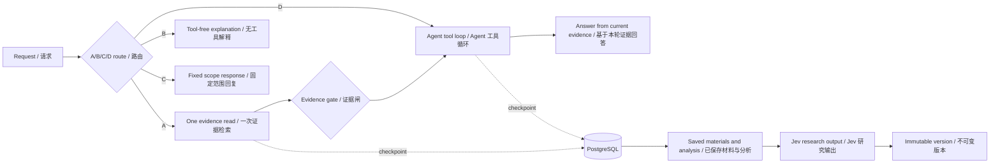

<div align="center">


# 📈 Market Evidence Agent

### 先找证据，再形成判断。
### Evidence first. Decisions you can revisit.

**把分散的公开资料、已保存的数据与 AI 分析，变成一条可核验、可回放、可修订的研究链。**
**Turn scattered public sources, saved data and AI analysis into a research trail you can verify, revisit and revise.**

[🚀 试用演示 / Try the demo](https://wp1461772181-glitch.github.io/market-evidence-agent/) · [📦 源码 / Source](https://github.com/wp1461772181-glitch/market-evidence-agent) · [🧭 中文](#中文) · [🇬🇧 English](#english)

[](https://github.com/wp1461772181-glitch/market-evidence-agent/actions/workflows/ci.yml)


</div>

> **演示说明 / Demo note** — GitHub Pages 提供前端；数据与 API 依赖维护者侧的独立后端。后端环境会影响演示可用性。  
> GitHub Pages serves the frontend; data and API actions depend on a separate maintainer-hosted backend, which affects demo availability.

## ✨ 为什么值得用 / Why it matters

- **证据先于结论 / Evidence before answers** — 回答绑定已保存的行情、SEC 文件、研究材料和引用坐标；公开网页研究是独立的只读能力，不会自动混入已核验材料。
- **判断可以回放 / Decisions you can replay** — 预测版本不可变并绑定固定目标；材料分析汇总为 `ResearchBrief`，记录来源版本与决策时点，后来新增了什么、判断如何变化都能回看。
- **模型可以替换 / Your model, your key** — 材料分析支持 11 种 OpenAI-compatible 模型服务配置（含自定义端点）；后台可设全局默认，单次任务可覆盖，API key 加密存储并在任务进入终态后清除。
- **引用经得起核对 / Citations you can check** — 引用按 exact → normalized → fuzzy 分层定位；仍定位不到时保留结论并明确标注「引用待核对」，而不是让整份分析失败。
- **一条研究闭环 / One research loop** — 材料采集 → 证据入库 → AI 分析（可配置模型）→ 引用核验 → ResearchBrief → 预测版本 → 修订候选 → 复盘。

> **2026-10-20 发布 / Latest release** — 本次更新聚焦 **可配置、可核验、可回放**：
>
> AI 材料分析可选 11 种模型服务配置（含自定义端点，后台全局默认 + 单次覆盖）；引用校验分为 exact / normalized / fuzzy / unverified，并保留「引用待核对」；预测修订新增 `preexisting` 类别；同时修复 Agent 对话页左侧菜单闭合时的按钮遮挡，并上线新 logo、favicon 与品牌 lockup。
>
> The 2026-10-20 release adds configurable analysis models across 11 provider configurations (including custom endpoints), layered citation verification with a visible “needs review” state, a new `preexisting` revision category, a navigation fix, and a new logo/favicon/lockup.

## 🧭 工作流 / Shared workflow



---

# 中文

<a id="中文"></a>

## 🌱 项目简介

Market Evidence Agent 是一个面向股票研究的**证据工作台**。它把公开资料、已保存行情、SEC 文件、研究材料和 AI 分析放在同一条可追溯链路上：你可以用自然语言提问，查看每条结论引用了哪段原文，保存不可变的预测版本，并在新材料出现时看到哪些内容可以修订、为什么可以修订。

它不是只给答案的聊天框，而是让研究过程更容易回看：**当时看到了什么、依据来自哪里、后来新增了什么、判断如何变化。**

## 💬 可以这样问

- “查一下 AAPL 最近保存的 SEC 文件有哪些？”
- “这份 10-K 对收入风险说了什么？请给我原文出处。”
- “搜索近期关于 NVIDIA 的产品新闻，并列出发布日期和来源。”
- “总结我保存的 MSFT 材料里，对现金流的不同说法。”
- “把这份 10-Q 用 OpenRouter 的 GPT-4o-mini 重新分析，并标出无法逐字定位的引用。”
- “这次预测之后有哪些新材料可以修订？为什么这份 30 天内的材料之前没用到？”
- “解释看跌、中性、看涨三类概率分别表示什么。”

公开网页研究是独立的只读能力，网页结果不会自动导入已保存材料；用户明确要求保存后，可由所有者确认入库。最近新闻检索会要求可解析的发布日期；显式时间跨度由 `days_back`（1–366 天）精确裁剪，未注明跨度的“最近”按近 7 天筛选。写操作会先显示操作与目标，等待确认。

## ✨ 能力一览

### 自然语言研究 Agent

请求通过**A 证据检索、B 无工具概念回答、C 固定范围回复、D Agent 工具循环**四类路径处理。A 路径先检索并校验证据，空结果仍可继续联网查找；D 路径直接进入工具循环。结构化模型调用决定路由与工具参数，没有基于公司名单或研究队列的硬编码路由。指代消解与分类是两个独立步骤；确认写入会冻结目标，并校验权限和重放。质量与发布状态见下方验收报告。

### 数据与网页研究

类型化的已保存数据读取工具覆盖价格历史、最新已保存预测、SEC 文件、材料、材料分析和研究 FAQ；`web_research` 是独立的只读能力。公开网页发现使用 Tavily，也可读取用户提供的 HTTPS 页面，并限制请求大小、跳转次数与摘录长度。网页摘录可能不完整或过时，不会自动变成已保存或已核验材料。

### 确认写操作与对话上下文

Agent 可提出写操作：只有所有者确认冻结目标的卡片后才执行，令牌绑定当前对话、10 分钟有效并防止重复执行。游客的队列和页面动作仅作用于当前浏览器。网页可经确认保存为 `web_news`，检索时持续标注网页来源。对话上下文分三层：近期轮次保留原文，较早轮次部分压缩，更早内容以追加式摘要保留。默认历史预算为 **64 KB**，可通过 `AGENT_CONTEXT_BUDGET_KB` 配置（16–128 KB）。摘要是记忆而非证据，回答依据来自本轮工具结果。

### 可配置 AI 材料分析

材料分析任务可以选择 **DeepSeek、Kimi、MiniMax、通义千问、智谱 GLM、豆包、腾讯混元、百度千帆、SiliconFlow、OpenRouter**，或自定义 OpenAI-compatible 端点。后台可设置全局默认；单次任务可以覆盖。每个任务会冻结自己使用的 provider、base URL 和 model，API key 加密存储，任务进入终态后清除。管理员可在 Agent 管理页设置默认模型，普通用户也可以在单次分析时选择“系统默认”或已保存的模型配置。

### 引用核验：精确、规范化、近似、待核对

每条引用先尝试 **exact** 逐字匹配；再尝试 **normalized**（全半角、引号、破折号、空白和零宽字符归一化）；再尝试 **fuzzy** 近似匹配（相似度阈值、长度差限制、最佳与次佳匹配差距）。仍无法定位时标记为 **unverified**：保留结论、标注「引用待核对」，不会让整份分析失败。首次尝试坏引用比例超过 10% 时，系统会带着坏 quote 自动重试一次；最终有效引用比例低于 50% 才判为无效输出。引用核验是“能否在原文中定位”的核验，不是事实正确性的证明。

### 预测修订：五类材料

预测修订候选分为五类，解释一份材料为什么可以进入本次修订：

- **new**：预测后 7 天内发布的新材料。
- **backfilled**：预测前 30 天内发布、但预测后才入库的材料。
- **preexisting**：预测前 30 天内发布、预测时已经入库、但本版预测未采用的材料。
- **updated**：预测已用材料的内容或审阅状态发生变化。
- **reanalyzed**：预测已用材料之后又生成了新的分析。

同一内容哈希的材料仍会被拒绝，避免把同一份内容换个记录重复计入。

### 可追溯分析与实验性判断

单份材料分析可汇总为 `ResearchBrief`，记录引用材料、来源版本与决策时点。预测版本不可变，并关联固定目标合同。Jev 输出看跌 / 中性 / 看涨三类概率，默认 `FORECAST_DECISION_MODE=research_only`。成熟度评估区分尚未到期和可评估目标；历史回放与校准研究不证明前向准确率，本地校准也不等于微调 Jev。

### 可选知识检索（RAG）

可选 BGE-M3 / Milvus 路径支持 dense、BM25、hybrid、RRF 和**可选 reranking**，并提供服务端范围约束与来源引用。基础 RAG 不要求 reranker 模型文件；启用额外能力前请看[知识库与 RAG 指南](https://github.com/wp1461772181-glitch/market-evidence-agent/blob/main/docs/knowledge-rag.md)。

## 🧭 流程图

上方共享流程图展示了读取与写入路径。公开网页研究不会自动入库；RAG 是可选检索路径。

## 🏗️ 技术栈与源码地图

| 部分 | 技术或入口 |
| --- | --- |
| 前端 | React 19、TypeScript、Vite；[应用入口](frontend/src/App.tsx)、[Agent 面板](frontend/src/AgentChatPanel.tsx)、[材料分析](frontend/src/MaterialAnalysisDetail.tsx) |
| API 与工作流 | Python 3.12、FastAPI、LangGraph；[工作流](app/agent_workflow/graph.py)、[直接工具循环](app/agent_workflow/direct.py)、[写操作](app/agent_workflow/consent.py) |
| 对话上下文 | 三层记忆与预算；[预算展示组件](frontend/src/ContextMeter.tsx) |
| 研究数据 | [保存数据工具](app/agent_tools.py)、[网页研究](app/agent_web_research.py)、[材料分析](app/material_analysis.py)、[ResearchBrief](app/research_brief.py) |
| 模型配置 | [provider catalog](app/model_providers.py)、[加密凭证盒](app/secret_box.py)；11 种 OpenAI-compatible provider 配置（含自定义端点） |
| 引用核验 | [引用 schema 与匹配](app/material_analysis_schema.py) |
| 预测修订 | [修订规则](app/forecast_revision_candidates.py)、[修订 API](app/forecast_v2_api.py) |
| 持久化与自动化 | PostgreSQL（含工作流检查点）；GitHub Actions 使用 PostgreSQL 16、Node.js 22；[CI 配置](.github/workflows/ci.yml) |

## 🚀 本地开发（可选）

需要 Python **3.12**、Node.js **22**，以及已配置并初始化 PostgreSQL 的本地环境。基础 Python API 也以数据库已就绪为前提；迁移、worker 和 RAG 是额外设置。仓库根目录没有 `docker-compose.yml`。

```bash
git clone https://github.com/wp1461772181-glitch/market-evidence-agent.git
cd market-evidence-agent

# 仅在没有现有配置时，从模板创建 .env
[ -f .env ] || cp .env.example .env

python3.12 -m venv .venv
source .venv/bin/activate
python -m pip install -e '.[test]'

cd frontend
npm ci
cd ..
```

请先阅读[本地后端与部署说明](docs/github-pages-local-backend.md)和[环境变量模板](.env.example)，按本地功能准备数据库和模型服务；密钥不要提交到 Git。首次启用材料分析时，创建相关表：

~~~bash
python scripts/migrate_material_analysis.py --apply
~~~

基础启动方式如下：

```bash
# Terminal 1: configured, initialized PostgreSQL must be available
source .venv/bin/activate
uvicorn app.main:app --reload

# Terminal 2
cd frontend
npm run dev
```

按 Vite 输出的本地地址打开前端。如果启用 RAG，建议使用独立的 `.venv-rag` 并安装 `requirements-rag.txt`；`scripts/run_api_server.sh` 在 `RAG_ENABLED=true` 时会优先选择它。RAG 另需其依赖、Milvus、知识 schema 和索引；请参阅 [RAG 指南](docs/knowledge-rag.md) 与 [`requirements-rag.txt`](requirements-rag.txt)。reranking 可选。

### 开发者检查（按需）

```bash
python -m pytest -q
cd frontend
npm run test:i18n
npm run build
```

## 📚 延伸阅读

- [对话上下文与预算](docs/agent-context.md)
- [Jev 本地校准与成熟度边界](docs/jev-local-learning.md)
- [自定义股票代码支持](docs/custom-stock-support.md)
- [Agent 工作流设计说明](docs/agent-research-v3-spec.md)
- [模型配置文件存储](docs/model-profile-storage.md)
- [路由与工具清单](docs/reports/agent-routing-inventory.md)
- [路由改造验收报告](docs/reports/agent-routing-verification.md)

## ⚖️ 研究边界

- 这是持续演进的研究原型，不是投资建议、交易系统或收益承诺。
- 三分类输出是实验性判断；历史回放和本地校准不证明前向准确率。
- 结果受已保存数据、网页可读性和模型配置影响；摘录可能不完整，证据门控不能替代核对原文。
- 引用核验只表示引用能否在冻结原文中定位，不代表事实正确；`unverified` 引用会保留但必须人工复核。
- 不同模型服务商可能给出不同分析与措辞；API key 应使用最小权限、可撤销的凭证。
- 后端取决于维护者侧环境；RAG 需要额外服务与索引。

---

# English

<a id="english"></a>

## 🌱 What it is

Market Evidence Agent is an **evidence workbench for equity research**. It keeps public sources, saved price history, SEC filings, research materials, and AI analysis on one traceable path: ask a natural-language question, inspect which source passage supports a claim, save an immutable forecast version, and see which materials can revise it — and why.

It is not just an answer box. The research trail stays easier to revisit: **what was available then, where a claim came from, what changed later, and how the judgment evolved.**

## 💬 Example prompts

- “Which AAPL SEC filings have been saved most recently?”
- “What does this 10-K say about revenue risks? Show the source.”
- “Search recent NVIDIA product news and include publication dates and sources.”
- “Compare saved MSFT materials that discuss cash flow.”
- “Re-analyze this 10-Q with OpenRouter GPT-4o-mini and flag citations that cannot be located verbatim.”
- “Which materials can revise this forecast, and why was this 30-day-old material not used before?”
- “Explain what bearish, neutral, and bullish probabilities mean.”

Public-web research is a separate read capability; web results are not automatically imported into saved materials. Write requests show their operation and targets for confirmation.

## ✨ What it includes

### Natural-language research agent

The current chat graph uses four direct routes: **A** performs one evidence read and gate before the agent loop, **B** answers in-scope concepts without tools, **C** returns a fixed out-of-scope response, and **D** enters the agent loop directly. The current direct path passes recent dialogue as reference context and uses typed model-selected read tools. Reference binding, evidence guards, permission checks and frozen write confirmations are implemented; current verification and deployment status are recorded in the linked report.

### Data and public-web research

A shared typed tool catalogue covers saved evidence, public research, workspace/status reads, queue/navigation actions and confirmed owner writes; see [the tool inventory](docs/reports/agent-routing-inventory.md). Public-web discovery uses Tavily and can also read a user-provided HTTPS page, with limits on request size, redirects, and excerpt length. Web excerpts may be incomplete or stale and do not automatically become saved or verified materials.

### Confirmed writes and conversation context

Owner write proposals freeze their targets and require a conversation-bound confirmation token, expiring after ten minutes, with durable replay protection. Guest queue and navigation actions stay in the browser. Confirmed public-page ingestion retains `web_news` provenance through retrieval. The default conversation context budget is **64 KB**, configurable with `AGENT_CONTEXT_BUDGET_KB` (16–128 KB); prior turns are reference context and do not count as evidence.

### Configurable AI material analysis

Material analysis jobs can use **DeepSeek, Kimi, MiniMax, Qwen, Zhipu GLM, Doubao, Tencent Hunyuan, Baidu Qianfan, SiliconFlow, OpenRouter**, or a custom OpenAI-compatible endpoint. An administrator can set a global default; a single job can override it. Each job freezes the provider, base URL, and model it used, stores the API key encrypted, and clears it when the job reaches a terminal state. The admin console exposes the default; the analysis panel exposes the per-job choice of the system default or a saved profile.

### Citation verification: exact, normalized, fuzzy, unverified

Each citation is first matched **exactly**; then **normalized** for full-width/half-width forms, quotes, dashes, whitespace, and zero-width characters; then **fuzzy** with a similarity threshold, length bound, and best-vs-second-best separation. If it still cannot be located, it is marked **unverified**: the conclusion is kept, the citation is labelled “needs review”, and the whole analysis is not discarded. If more than 10% of citations fail on the first attempt, the worker retries once with the bad quotes; only a final verified ratio below 50% is treated as invalid output. Citation verification proves locatability, not factual correctness.

### Forecast revision: five categories

Revision candidates explain why a material may enter the revision:

- **new**: published within seven days after the forecast.
- **backfilled**: published within the thirty days before it, but stored only after it was made.
- **preexisting**: published within the thirty days before it, already stored at decision time, but not used by that forecast.
- **updated**: a used material's content or review state changed.
- **reanalyzed**: a used material was analysed again after the forecast.

A copy of already-used content under another record is still rejected.

### Traceable analysis and experimental judgments

Individual material analyses can be synthesized into a `ResearchBrief` with source-version references and a decision time. Forecast versions are immutable and linked to a fixed target contract. Jev produces bearish / neutral / bullish probabilities, with `FORECAST_DECISION_MODE=research_only` as the default. Maturity evaluation distinguishes pending targets from evaluable ones; historical replay and calibration research do not establish forward accuracy, and local calibration is not model fine-tuning.

### Optional knowledge retrieval (RAG)

The optional BGE-M3 / Milvus path supports dense, BM25, hybrid, RRF, and **optional reranking**, with server-side scope constraints and source quotes. Reranker model files are not required for basic RAG. See the [knowledge and RAG guide](https://github.com/wp1461772181-glitch/market-evidence-agent/blob/main/docs/knowledge-rag.md) before enabling additional components.

## 🧭 Workflow

The shared diagram above shows the read and write paths. Public-web research is not an automatic import pipeline, and RAG is optional.

## 🏗️ Technology and source map

| Area | Technology or entry point |
| --- | --- |
| Frontend | React 19, TypeScript, Vite; [app entry](frontend/src/App.tsx), [agent panel](frontend/src/AgentChatPanel.tsx), [material analysis](frontend/src/MaterialAnalysisDetail.tsx) |
| API and workflow | Python 3.12, FastAPI, LangGraph; [workflow](app/agent_workflow/graph.py), [direct tool loop](app/agent_workflow/direct.py), [write actions](app/agent_workflow/consent.py) |
| Conversation context | Three-layer memory and budget; [budget display component](frontend/src/ContextMeter.tsx) |
| Research data | [saved-data tools](app/agent_tools.py), [web research](app/agent_web_research.py), [material analysis](app/material_analysis.py), [ResearchBrief](app/research_brief.py) |
| Model configuration | [provider catalog](app/model_providers.py), [encrypted credential box](app/secret_box.py); 11 OpenAI-compatible provider configurations (including custom endpoints) |
| Citation verification | [citation schema and matching](app/material_analysis_schema.py) |
| Forecast revision | [revision rules](app/forecast_revision_candidates.py), [revision API](app/forecast_v2_api.py) |
| Persistence and automation | PostgreSQL checkpoints; GitHub Actions with PostgreSQL 16 and Node.js 22; [CI workflow](.github/workflows/ci.yml) |

## 🚀 Local development (optional)

Requires Python **3.12**, Node.js **22**, and a configured, initialized local PostgreSQL environment. The basic Python API also assumes the database is ready; migrations, workers, and RAG require additional setup. There is no root `docker-compose.yml`.

```bash
git clone https://github.com/wp1461772181-glitch/market-evidence-agent.git
cd market-evidence-agent

# Create .env from the template only when no config already exists.
[ -f .env ] || cp .env.example .env

python3.12 -m venv .venv
source .venv/bin/activate
python -m pip install -e '.[test]'

cd frontend
npm ci
cd ..
```

Read the [local backend and deployment guide](docs/github-pages-local-backend.md) and [environment template](.env.example) to prepare your database, model service, and local settings. Keep real secrets out of Git. To create the material-analysis tables on first use:

~~~bash
python scripts/migrate_material_analysis.py --apply
~~~

To run the servers:

```bash
# Terminal 1: configured, initialized PostgreSQL must be available
source .venv/bin/activate
uvicorn app.main:app --reload

# Terminal 2
cd frontend
npm run dev
```

Open the local address printed by Vite. If RAG is enabled, use a separate `.venv-rag` environment and install `requirements-rag.txt`; `scripts/run_api_server.sh` prefers it when `RAG_ENABLED=true`. RAG separately requires its dependencies, Milvus, knowledge schema, and indexing; see the [RAG guide](docs/knowledge-rag.md) and [`requirements-rag.txt`](requirements-rag.txt). Reranking is optional.

### Optional developer checks

```bash
python -m pytest -q
cd frontend
npm run test:i18n
npm run build
```

## 📚 Further reading

- [Conversation context and budget](docs/agent-context.md)
- [Jev local calibration and maturity boundaries](docs/jev-local-learning.md)
- [Custom stock-symbol support](docs/custom-stock-support.md)
- [Agent workflow design](docs/agent-research-v3-spec.md)
- [Model-profile storage](docs/model-profile-storage.md)
- [Routing and tool inventory](docs/reports/agent-routing-inventory.md)
- [Routing verification report](docs/reports/agent-routing-verification.md)

## ⚖️ Research limitations

- This is an evolving research prototype, not investment advice, a trading system, or a promise of returns.
- Three-class outputs are experimental; historical replay and local calibration do not establish forward accuracy.
- Results depend on saved data, page availability, and model configuration. Excerpts may be incomplete, and evidence gates do not replace checking original sources.
- Citation verification only proves locatability in the frozen text, not factual correctness; `unverified` citations are retained but must be reviewed.
- Different model providers may produce different analyses and wording; use least-privilege, revocable API keys.
- Backend actions depend on the maintainer-hosted environment; RAG needs additional services and indexing.

---

## 🧾 验收与发布 / Verification and release

- **2026-10-16** — C1–C14 routing implementation, 50 DeepSeek-Flash behavior cases, permission checks, test migration and the verified release are recorded in the [routing verification report](docs/reports/agent-routing-verification.md).
- **2026-10-20** — configurable analysis models, layered citation verification, the `preexisting` revision category, the navigation fix and the new logo passed CI and shipped in [66d986a](https://github.com/wp1461772181-glitch/market-evidence-agent/commit/66d986a).
