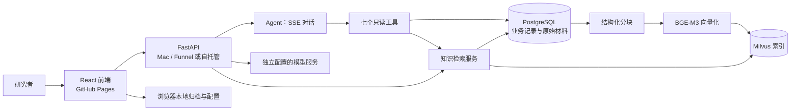

# Market Evidence Agent

[中文](README.md) | [English](README.en.md)

**演示：**[打开研究工作台](https://wp1461772181-glitch.github.io/market-evidence-agent/) · **仓库：**[wp1461772181-glitch/market-evidence-agent](https://github.com/wp1461772181-glitch/market-evidence-agent)

Market Evidence Agent 是面向个人美股研究者的研究工作台。它集中展示已保存的行情、SEC 文件、研究材料和版本化分析，并提供基于已保存证据的有限 Agent 对话。研究者可以发现材料线索、检查来源、保存分析，并查看预测版本与后续修订。

产品关注研究过程是否可检查、证据是否可追溯，以及结论能否随新材料修订。它不承诺股价预测准确，也不是交易执行或实时行情服务。

## Agent 对话

- 全页面 SSE 对话逐步显示状态、工具调用、结果和回答，并以清晰徽标展示工具活动。
- 开发工作树中的 LangGraph 工作流按意图先读取必需来源、检查证据，再执行有限多步只读工具调用与回答；不在线抓取 SEC，也不执行写入操作。该版本尚未部署到公开演示。
- `web_research` 可按用户请求通过 Tavily 搜索公开网页，或读取公开 HTTPS 页面；默认需单独配置后端 `TAVILY_API_KEY`。网页摘录有长度限制，搜索摘要不作为网页正文；失败会明确返回。公开 URL 读取不需要 Tavily Key。
- 回答支持 Markdown、表格、来源引用和原文引句。用户可以复制回答、定位问题并查看对话中的来源。
- 对话和工具轨迹按身份保存在服务端，访客与个人身份隔离。用户可导出本地 JSON 对话归档作为备份。

| 工具 | 用途 |
| --- | --- |
| `query_stock_prices` | 查询已保存的日线 OHLCV 和抓取时间，不提供实时报价。 |
| `query_latest_forecast` | 查询该股票当前研究预测版本、状态、时间和摘要。 |
| `query_materials` | 搜索已保存的 SEC 文件摘录和用户上传材料，不搜索 FAQ。 |
| `query_sec_filings` | 查询已保存的 SEC 文件目录及已抓取摘录，不访问 SEC。 |
| `query_research_faq` | 查询已批准的研究 FAQ。 |
| `query_material_analysis` | 读取某份材料最新保存的 AI 分析及其来源关联。 |
| `search_material_analysis` | 搜索已保存的 AI 分析；这些分析是派生材料。 |

## 试用

1. 打开[在线演示](https://wp1461772181-glitch.github.io/market-evidence-agent/)，可访客浏览；写入类操作需要个人身份。
2. 在模型设置中填写配置卡片的显示名称、服务端点、模型 ID 和自己的模型 Key，运行连通性测试并保存。选择该配置后即可在对话输入框中使用。模型配置步骤见[模型配置与存储说明](docs/model-profile-storage.md)。
3. 可以询问已保存材料中的原文引句，或询问已保存 AMD 分析里的支持线索、反对线索和关键数字；再查看回答引用的来源。

访客不会获得管理员权限；模型 Key 由用户在模型设置中提供，不是演示服务器提供的共享 Key。

## 模型配置与本地对话归档

- 可选预设模型或自定义 HTTPS 服务地址，并填写模型 ID 与显示名称；界面支持连通性测试、保存配置卡片和在对话输入区选择配置。
- 支持模型发现的服务最多返回五个模型建议。服务商目录包括 DeepSeek、Kimi、MiniMax、Qwen、智谱、豆包、混元、百度、SiliconFlow、OpenRouter 和自定义端点；发现能力因服务而异。
- 浏览器凭据使用 OPFS/IndexedDB；本地部署也可选择单独配置的服务端文件模式。浏览器不会把任意项目明文文件当作凭据库，这不代表静态加密。
- 聊天历史不保存服务商 API Key。自动归档取决于浏览器能力，重载后需要重新选择归档文件。归档是本地对话记录，不是证据库；详见[对话归档说明](docs/chat-local-files.md)。

## 研究材料与检索

材料库管理已批准的 FAQ、抓取的 SEC 文件摘录，以及用户上传的 TXT、Markdown 和 PDF（不含 OCR）。后台提供上传/导入、检索测试和索引状态查看。PostgreSQL 保存原始材料、分块、任务和分析版本；Milvus 保存向量索引；BGE-M3 生成稠密向量，线上演示当前采用稠密检索与 BM25 经 RRF 融合的混合检索。可通过配置启用 `bge-reranker-v2-m3` 重排。

解析会保留文档结构和表格表头。检索按所有者、股票、时间和版本范围过滤，支持幂等重试、重新索引和指向精确来源的引用。

### 保存的分析也会成为知识

保存的 AI 分析可进入知识检索，覆盖六类内容：摘要、事实、支持性推断、反向推断、关键数字和不确定性。分析保留版本、模型信息和原文引句；索引结果遵循公开/私有范围及所有者隔离。这些内容是从原始材料派生的 AI 分析，不等于经过独立核实的事实。

公开验证中，两份已保存的 AMD 分析生成了 66 个分块，并完成索引、查询和引用回读。这验证了处理链路，不代表所有历史资料均已回填，也不保证每个问题都能准确检索。对话复盘与抽取是单独的可选操作，不会自动学习全部聊天。

## 研究工作台

- **关注列表与总览：**用户可维护美股代码列表；默认提供七只示例股票。股票详情按代码组织行情、材料、预测和评估。
- **行情与基准：**展示已保存的 OHLCV 和 SPY 对照蜡烛图，并标注数据日期与抓取时间。历史快照支持按时间边界读取。
- **SEC 文件：**保存文件目录、来源链接和已抓取摘录；可从材料工作流发起扫描。Agent 只读已保存记录，不会在线抓取。
- **材料分析：**为材料生成并缓存 AI 分析，保留版本、原文引句和引用导航。再次打开已保存分析不会重新调用模型。
- **研究流程：**可复用材料分析生成 ResearchBrief，再交给实验性的 Jev 三分类决策模型评估看涨、中性或看跌。Jev 消费研究简报，不负责生成简报；固定目标与到期评估随不可变版本保存。
- **评估与运行状态：**查看到期评估、历史回放、后台队列和监控状态。四种检索策略的 Recall@K/MRR 评测工具已实现；合成数据结果不能代表生产准确率。
- **新闻线索：**保存新闻线索与聊天中的公开网页检索是两条独立只读路径；聊天不会自动保存网页为研究材料。

Jev 预测会保留原始概率。系统具备基于已到期观察样本的本地校准流程，候选只有通过时间顺序留出验证后才可启用；历史回放的校准研究与实时样本分开。输出仍属实验性研究结果，不代表已获前向验证的投资胜率。

## 架构

PostgreSQL 保存业务记录、原文、分块、任务和对话；Milvus 保存检索索引。原文与向量索引分开更新，不构成原子双写。模型服务与业务数据库分别配置。公开演示前端托管于 GitHub Pages，后端运行在维护者 Mac 并通过 Funnel 提供访问，因此演示依赖该主机在线；也可按文档在本地自托管。

## 当前边界

Agent 只读已保存记录；显式网页研究可读取有界的公开网页摘录，不执行交易，也不实时查询行情或在线抓取 SEC。开发工作树中的编排已进入持久化 LangGraph；公开演示仍运行已发布版本。证据门控是启发式检查，回答仍可能出错；引用不能证明每次回答都完全忠实。

预测、材料分析和检索结果都需要研究者对照原始来源与时间核查。预测评估只对结果已成熟且数据可用的样本有意义；历史回放或合成检索指标不能说明未来表现。高并发保证与端到端原子写入尚未验收；真实模型、Tavily 搜索和公开部署仍待独立验收。

## 文档导航

- [本地运行与部署说明](docs/github-pages-local-backend.md)
- [对话归档文件说明](docs/chat-local-files.md)
- [模型配置与存储](docs/model-profile-storage.md) · [模型发现](docs/model-discovery.md)
- [知识检索说明](docs/knowledge-rag.md) · [四策略评测报告](docs/knowledge-rag-ch34-reports/four-strategy-evaluation.md)
- [自定义股票支持](docs/custom-stock-support.md) · [实验预测与学习边界](docs/jev-local-learning.md)

## 后续方向

下一步是对开发工作树进行真实模型与 Tavily 搜索验收，并在独立审核后发布。系统没有实现多 Agent 自主协作或模型微调。
