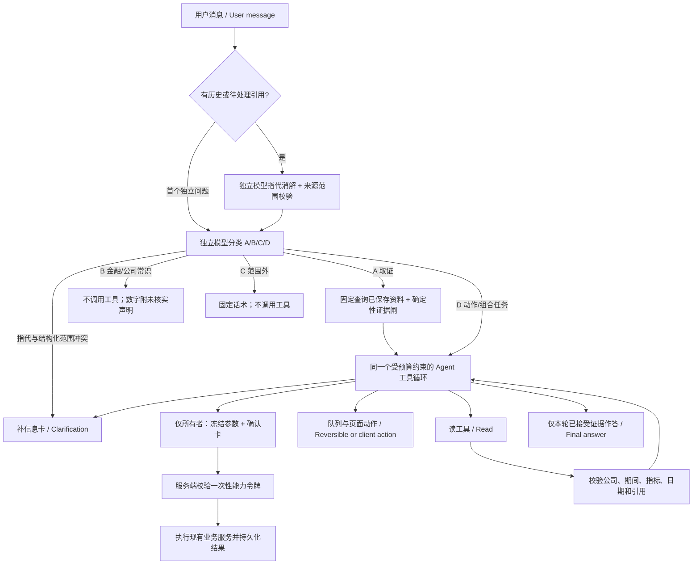

# Agent workflow / Agent 工作流

此文描述本分支的实现；线上版本以发布记录中的 SHA 为准。验收结果见 [路由改造报告](reports/agent-routing-verification.md)，完整设计见 [C1–C14 规范](superpowers/specs/2026-10-15-agent-routing-redesign.zh-CN.md)。

A 的固定检索为空时仍进入循环，可以联网查找。研究队列不限制可查询的公司。B 的数字来自模型常识时标明未经资料核实；C 不调用工具。指代解析与分类是独立调用，真正的首个独立问题跳过解析。历史、摘要和网页正文都不能赋予写权限；回答模型读取本轮已接受证据、操作状态和服务器结果目录。

仅调整时间窗口或结果数量的追问由指代模型标为 `refinement`，保留前轮的指标、财报范围、表单与期间。若独立分类给出冲突的范围，在执行任何工具前出补信息卡；不靠“股价”等词语猜测谁正确。正常的明确任务切换由 `new` / `followup` 表达。新闻 refinement 不能绕过参数边界调用股价工具。

## Tools and permissions / 工具与权限

[集中工具目录](../app/agent_tool_catalog.py) 声明名称、说明、Pydantic 参数、级别、所有者/游客权限、确认要求和错误提示。A、D 共用目录；游客看不到写级工具。完整接口映射见 [工具与词表清单](reports/agent-routing-inventory.md)。

- 读：已保存价格、预测、材料、SEC 原文、FAQ、派生分析、知识库、公开网页、队列、任务/监控/评估/回放及工作区记录。
- 可逆/客户端动作：加入或移出队列、切换股票、打开页面；所有者队列写自己的数据库记录，游客只接收浏览器动作。浏览器按动作 ID 去重。
- 有成本或难撤销：SEC 抓取/刷新、分析、导入、索引、预测、行情初始化、官方扫描、历史回放、预测修订、翻译与知识候选审核；必须先生成所有者确认卡。
- 不开放：登录码、模型密钥/配置、清库、删除对话。

确认卡冻结操作与目标。随机令牌绑定所有者、对话、参数摘要，10 分钟有效。数据库锁覆盖消费和业务执行，已完成的消费返回持久化结果；崩溃后停留在 executing 的请求不得自动重放。原有写服务继续使用幂等台账。改变操作需取消旧提案并重新提交；网页里的“导入本页”不构成用户授权。

## Public web and saved web news / 网页与网页入库

`web_research(query, company?, days_back?, max_results?)` 接收模型填好的参数。`days_back` 范围 1–366，最近新闻按 7 天、半个月按 15 天；搜索范围之后再按可解析的发布日期精确裁剪。只有明确时间跨度在模型漏填时才由 `freshness.py` 作兼容兜底。公开 HTTPS 抓取沿用有地址固定、重定向校验和大小限制的传输；搜索摘要不冒充正文。

`ingest_web_source` 只接受本轮或服务器已返回结果中的 URL。用户明确要求保存（含条件保存）且为所有者时，才可出确认卡。比较条件使用服务器证据日期；卡片显示库内日期、网页日期、标题、URL 和 SEC 替代方案。较旧/相同或已入库的 URL 不产生新提案。

提案时冻结用户已看到的正文快照、URL、日期和哈希；确认后直接保存该快照，不重新抓取网页。保存有大小限制的正文快照、规范化 URL、内容哈希、发布时间、抓取时间与提取方法。URL/正文在所有者范围内去重。保存记录与知识文档保持 private；同步、建索引、检索和引用始终保留 `source_type=web_news`，不会升级成官方文件。知识表仍需按现有显式迁移流程准备，启动过程只自动创建新增的 agent 表，不修改既有表。

## Budgets and failures / 预算与停止

默认成功调用最多 6 个不同调用（可配置为 6–8），全局最多 12 次（包括重试）；同一可重试错误额外重试最多 2 次。参数错误交给模型修正，不作网络重试。保留 token 和 120 秒回合预算，并为已传入的历史留出额度。

- `too_many_steps`：任务过多，保留已有来源，提示拆分剩余任务。
- `tool_failures`：报告失败的工具、尝试次数与安全原因码。
- `no_progress`：相同调用或持续没有新证据，停止打转。

到限额后禁用工具作一次部分结果回答。正文中出现工具协议标记时重试一次，仍失败报 `provider_protocol_invalid`。失败/被闸拒绝的正文不进入回答上下文；引用不存在的来源不能作为成功回答。数量型金额还会与所引证据进行单位归一化核对；有限的事件护栏检查来源类别与否定极性，句号后的引用仍绑定前句。这不能替代完整的语义事实核验。

可选的 claim 闸（`CLAIM_QUOTE_GATE`，默认 `off`）在 shadow/enforce 时要求正文后附带 `claims` JSON：引文必须能定位到来源原文，数字只核对定位后的原文片段；价格、XBRL、预测和 calculate 用字段绑定。找不到引文就丢掉该句并重修，不标成待核对。`CLAIM_JEV_SUPPORT`（默认 `off`）是另一条 Jev 问题 `jev-claim-support-v1`，与预测方向 `jev-direction-v1` 分开，1 次尝试、超时不超过 5 秒；只有明确 `does_not_support` 才会在 enforce 时丢掉该句。开启 shadow 的方式见 [claim-support label protocol](claim-support-label-protocol.md)。方向 Jev 的“未经校准”说明不变。

正常收尾的数字回答若被拒，且已有证据、没有待确认操作、预算充足，最多进行一次无工具重写。模型返回严格 JSON 的逐句正文与来源编号，服务端逐句附引用，再经过相同的数字、引用和事件护栏；非法 JSON、伪引用或再次不合格仍拒绝，协议错误也不追加重试。该调用只读取本轮接受的证据和标为数据的被拒草稿，计入模型用量与回合预算，不执行工具，也不能产生新的写授权或确认卡。金额支持 B/M/K 与万亿；事件护栏区分离任和辞职、任命和实际开始任职。

## Verification / 验证

常规测试只用可控模型回调与外部 I/O；确认、去重、权限、重放与引用恢复使用临时 PostgreSQL 数据库。真实模型验收使用 [50 条 JSONL](../scripts/evaluation/cases/agent-routing-v3.jsonl) 和 [评测脚本](../scripts/evaluation/routing_acceptance.py)，模型、费用、调用数与延迟记录在验收报告中。限制/错误探针与真实模型质量样本分别标注，不把模拟选择当成模型准确率。

实际模型验收使用用户指定的 DeepSeek 官方 `deepseek-flash`，请求强度由 `AGENT_REASONING_EFFORT` 控制，默认 low；OpenRouter 使用自身的原生 effort 参数。显式 default 或未知设置不传该参数。最终结果与 provider 费用边界见验收报告。
