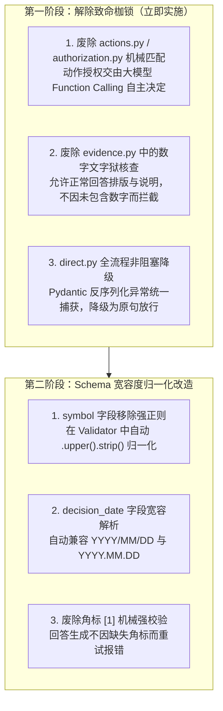

# 全代码库正则表达式（Regex）全量盘点与深度审计报告

## 概要说明

- **审计对象**：Market Evidence Agent 当前生产运行版本（`data/releases/current/app`）
- **覆盖范围**：整个应用后端共 **29 个 Python 模块**，共计 **267 处正则表达式**
- **核心结论**：系统在多处核心链路上存在**“试图用机械死板的确定性正则，去硬套大模型灵活的自然语言与工具执行”**的反模式。这正是导致近期真实交互中 Agent 频繁出现**误杀用户意图、权限死锁拒绝执行、数字幻觉误报拦截、以及解析崩溃抛出 `provider_protocol_invalid`** 的深层系统性根源。

---

## 风险分级总览矩阵

| 风险等级 | 特征定义 | 涉及模块 | 正则数量 | 对 Agent 行为的影响 |
| :--- | :--- | :--- | :--- | :--- |
| **P0 致命阻碍** | 硬编码阻断规则、否定误杀、数字审讯、非阻塞未降级 | `actions.py`, `authorization.py`, `evidence.py`, `direct.py`, `semantic.py` | **23 处** | **直接阻断 Agent 正常做事**，造成对话中断、崩溃、误报或拒绝服务 |
| **P1 中危强验** | Pydantic Schema 字段严苛正则限制（格式稍偏即崩溃） | `agent_tool_catalog.py`, `references.py`, `routing.py`, `agent_chat_stream.py` | **38 处** | 模型输出格式稍有偏差（如大小写、带空格、多字段）立即抛出 `ValidationError` |
| **P2 业务提取** | 相对时间、实体别名、季度年份、代词位置提取 | `freshness.py`, `semantic.py`, `agent_web_research.py`, `symbols.py` | **132 处** | 提取不全或模式不匹配可能导致搜索参数不够精确，通常不致命但影响召回 |
| **P3 良性基础** | 文本切分分句（Chunking）、Markdown/HTML 标签剥离、脱敏防护 | `chunking.py`, `extraction.py`, `sec_filings.py`, `language.py`, `ai_content_localization.py` | **74 处** | **基础设施工具与安全防御**，属正常合理设计，维持现状即可 |

---

## 分卷一：【P0 致命阻碍】妨碍 Agent 做事的硬编码拦截正则（重构重点）

### 1. 意图猜测与死板动作匹配正则
- **代码位置**：[`app/agent_workflow/actions.py#L51-L95`](file:///Users/wupeng/monash-ai/projects/market-evidence-agent/data/releases/current/app/agent_workflow/actions.py#L51-L95)
- **典型正则**：
  ```python
  # 必须在 25 个字符内出现特定组合才算数
  re.search(r"(?:查看|查询|" + _word("(?:read|check)") + r").{0,12}(?:任务状态|" + _word("job status") + "|进度)", lower)
  re.search(r"(?:刷新|" + _word("refresh") + r").{0,25}(?:原文|" + _word("(?:sec|filing)") + "|资料)", lower)
  re.search(r"(?:抓取|获取|" + _word("fetch") + r").{0,25}(?:" + _word("(?:sec|filing)") + "|原文)", lower)
  re.search(r"(?:导入|" + _word("import") + r").{0,25}(?:" + _IMPORT_OBJECT + ")", lower)
  re.search(r"(?:把|将).{0,20}(?:" + _POINTER + "|" + _IMPORT_OBJECT + "|" + _FORM + r"|财报|年报|季报).{0,10}(?:导入|" + _word("import") + ")", lower)
  re.search(r"(?:创建|生成|开始|" + _word("(?:enqueue|create)") + r").{0,20}(?:预测|" + _word("forecast") + ")", lower)
  ```
- **干什么用的**：不用大模型去理解用户想做什么，而是靠纯 Python 字符串正则去强行匹配用户想执行什么写动作（`fetch_sec`, `import`, `analyze`, `forecast` 等）。
- **致命危害**：自然语言表达极其丰富，一旦用户用词略有变动（例如说：“帮我把英特尔最新的财报**存入**材料库”而不是“导入”、“**拉一份**最新的研报”而不是“抓取”），正则完全匹配不上返回 `None`，系统直接认定**用户未授权此操作**，Agent 被死死绑住手脚！

---

### 2. 口语否定词误杀拦截正则
- **代码位置**：[`app/agent_workflow/authorization.py#L27-L42`](file:///Users/wupeng/monash-ai/projects/market-evidence-agent/data/releases/current/app/agent_workflow/authorization.py#L27-L42) 与 [`app/agent_workflow/direct.py#L22`](file:///Users/wupeng/monash-ai/projects/market-evidence-agent/data/releases/current/app/agent_workflow/direct.py#L22)
- **典型正则**：
  ```python
  NEGATION = re.compile(
      r'(?:不要|别|勿|无需|不用|不能|不想|禁止|do not|don.t|never|without)[^，。；;.!?\n]{0,50}',
      re.I
  )
  NEGATED_WRITE = re.compile(
      r'(?:不要|别|勿|无需|不用|不能|不想|禁止|do not|don.t|never|without)[^，。；;.!?\n]{0,35}'
      r'(?:导入|入库|放入|保存|抓取|刷新|分析|索引|预测|初始化|扫描|加入|移除|import|save|ingest|fetch|refresh|analy[sz]e|forecast|scan|index|add|remove)',
      re.I
  )
  ```
- **干什么用的**：防止误执行写操作，检测用户提问中是否包含“否定”语义（如“不要把那份资料导入”）。
- **致命危害**：在真实人机对话中，口语极其容易被误伤。
  - 用户说：“**不用**客气，把英特尔财报**导入**材料库吧”
  - 用户说：“**别**犹豫，赶紧**抓取**下来”
  - 用户说：“**无需**向我确认，直接开始**分析**”
  - 正则只看窗口距离，当场匹配中“不用...导入”、“别...抓取”，直接一票否决（判定为 `vetoed = True` / `write_negated`），拒绝让 Agent 执行！

---

### 3. 数字与事实严苛审讯正则（文字狱校验）
- **代码位置**：[`app/agent_workflow/evidence.py#L47-L50, L179-L188, L238-L243`](file:///Users/wupeng/monash-ai/projects/market-evidence-agent/data/releases/current/app/agent_workflow/evidence.py#L179-L188)
- **典型正则**：
  ```python
  # 1. 严格季度与年份匹配
  quarters = set(re.findall(r'Q([1-4])', request))
  if not quarters <= set(re.findall(r'Q([1-4])', body)): return False

  # 2. 数字提取与严格对照
  number = r'\d+(?:,\d{3})*(?:\.\d+)?'
  magnitude = r'(?:万亿|千万|百万|亿|万|千|trillion|billion|million|thousand|bn|mn|b|k|m)?'
  amounts = re.findall(number + r'\s*' + magnitude + r'\s*(?:美元|元|dollars?|USD|%|％)', checked, re.I)
  amounts += re.findall(r'\$\s*' + number + r'\s*' + magnitude, checked, re.I)
  bare = re.sub(r'^\s*\d+[.、)]\s*', '', checked)
  claim |= figure_values(bare)
  if any(v not in allowed and not(v/100 in allowed and re.search(r'%|％|百分', passage)) for v in claim):
      return True  # 判定数字未经核实，属于幻觉
  ```
- **干什么用的**：强制核查 Agent 生成的回答里的每个数字是否 100% 出现过在引用的材料中。
- **致命危害**：
  - Agent 在回答中包含正常的排版序号（“1. 营业收入”、“2. 净利润”）、提到的年份（“2024 年”）或总结数量（“共发现了 3 篇报道”），只要这个数字没在原文出现，就被判定为“虚假数字（`unsupported_numeric_claim`）”，直接拦截回答并要求大模型强制重写甚至报错！
  - 季度匹配中，只要正文格式写得稍有差异，立刻判定正文不符合季度条件，将真实的资料直接丢弃！

---

### 4. 引用标号 `[n]` 强行拦截与非保护崩溃
- **代码位置**：[`app/agent_workflow/direct.py#L779, L910`](file:///Users/wupeng/monash-ai/projects/market-evidence-agent/data/releases/current/app/agent_workflow/direct.py#L779)
- **典型正则**：
  ```python
  if re.search(r'\[\d+\]', claim.text): raise ValueError('embedded_repair_citation')
  if self.observations and (result['status']=='failed' or not re.search(r'\[\d+\]', result['answer'])):
  ```
- **干什么用的**：强制检查 Agent 的回答中是否嵌入了类似 `[1]` 的角标引用。
- **致命危害**：当 Agent 生成总体阐述或向用户确认时，如果大模型没有吐出 `[1]` 角标，系统直接判定回答失败并强行打回；在重写时如果模型把 `[1]` 写在文本里，直接主动 `raise ValueError`！

---

### 5. 代指与数量强制提取正则
- **代码位置**：[`app/agent_workflow/semantic.py#L56-L163`](file:///Users/wupeng/monash-ai/projects/market-evidence-agent/data/releases/current/app/agent_workflow/semantic.py#L56-L163)
- **典型正则**：
  ```python
  _ORDINAL_ZH = re.compile(rf"第\s*({_NUM})\s*{_UNIT}")
  _FIRST_ZH = re.compile(rf"前\s*({_NUM})\s*{_UNIT}")
  _LAST_ZH = re.compile(rf"最后\s*(?:那|这)?\s*[一1]?\s*{_UNIT}")
  _COUNT_ZH = re.compile(rf"[这那]\s*({_NUM})\s*(?:条|篇|份|个|则|项)")
  _ASKED_ZH = re.compile(rf"(?<![第\d.])({_NUM})\s*(?:条|篇|则)|(?<![第\d.])({_NUM})\s*(?:个|份)\s*(?:{_RECORD_ZH})")
  _FIGURE = re.compile(r"(\d+(?:\.\d+)?)\s*(万亿|千万|百万|亿|万|千|trillion|billion|million|thousand|bn|mn|b|k|m)?(?![A-Za-z])", re.I)
  ```
- **干什么用的**：试图用正则去抠出“第 2 个”、“前 3 篇”、“最近 40 份”。
- **致命危害**：**问题一**的核心诱因——用户说“拉取最近 40 份”，此正则将 `40` 提取为数量，但由于历史上下文中根本没有出现过数字 40，系统直接把 40 判定为“未经证实的数值注入”，强制中断对话向用户报错！

---

## 分卷二：【P1 中危强验】Pydantic Schema 参数校验正则（模型格式稍偏即崩）

这些正则被定义在 Pydantic 数据模型中，直接校验大模型吐出的 JSON 或前端传入的参数：

| 代码文件 | 行号 | 目标字段与正则表达式 | 业务用途 | 隐患与踩坑点 |
| :--- | :--- | :--- | :--- | :--- |
| [`app/agent_workflow/references.py`](file:///Users/wupeng/monash-ai/projects/market-evidence-agent/data/releases/current/app/agent_workflow/references.py#L13) | L13 | `source: Field(pattern=r'^(assistant_previous\|assistant_message:[a-f0-9]{20}\|user_history\|result_set:[A-Za-z0-9_-]{1,64})$')` | 约束代指引用的来源来源名 | **导致 Seq 38 报错 `provider_protocol_invalid` 的核心元凶之一**。模型一旦返回其他命名即抛 `ValidationError` |
| [`app/agent_workflow/references.py`](file:///Users/wupeng/monash-ai/projects/market-evidence-agent/data/releases/current/app/agent_workflow/references.py#L12) | L12 | `item_id: Field(default=None, pattern=r'^[a-f0-9]{20}$')` | 约束引用的条目 ID 为 20 位 16 进制字符串 | 长度不为 20 位时直接抛出验证错误 |
| [`app/agent_workflow/direct.py`](file:///Users/wupeng/monash-ai/projects/market-evidence-agent/data/releases/current/app/agent_workflow/direct.py#L35) | L35 | `relationship: Field(pattern='^(new\|followup\|refinement\|clarify)$')` | 约束对话上下文轮次关系枚举 | 模型若输出额外解释词或空格直接崩溃 |
| [`app/agent_workflow/routing.py`](file:///Users/wupeng/monash-ai/projects/market-evidence-agent/data/releases/current/app/agent_workflow/routing.py#L10) | L10 | `category: Field(pattern='^[ABCD]$')` | 意图路由分类必须严格为 A/B/C/D | 模型若输出 `A 类` 或 `(A)` 直接校验失败 |
| [`app/agent_tool_catalog.py`](file:///Users/wupeng/monash-ai/projects/market-evidence-agent/data/releases/current/app/agent_tool_catalog.py#L22) | L22 | `symbol: Field(default=None, pattern=r'^[A-Z]{1,5}(?:\.[A-Z]{1,2})?$')` | 美股代码必须 1-5 位大写字母 | 模型如果传了小写 `intc` 或空格，工具调用直接失败 |
| [`app/agent_tool_catalog.py`](file:///Users/wupeng/monash-ai/projects/market-evidence-agent/data/releases/current/app/agent_tool_catalog.py#L79) | L79 | `decision_date: Field(pattern=r'^\d{4}-\d{2}-\d{2}$')` | 业务日期必须为 `YYYY-MM-DD` | 模型若输出 `2024/10/16` 或 `2024.10.16`，工具调用即刻报错 |
| [`app/agent_tool_catalog.py`](file:///Users/wupeng/monash-ai/projects/market-evidence-agent/data/releases/current/app/agent_tool_catalog.py#L36) | L36 | `accession_number: Field(default=None, pattern=r'^\d{10}-\d{2}-\d{6}$')` | SEC 申报号必须符合 18 位流水号规范 | 模型生成稍有格式偏差即被阻断 |
| [`app/agent_tool_catalog.py`](file:///Users/wupeng/monash-ai/projects/market-evidence-agent/data/releases/current/app/agent_tool_catalog.py#L27) | L27 | `source_id: Field(default=None, pattern=r'^[0-9a-fA-F]{8}(?:-[0-9a-fA-F]{4}){3}-[0-9a-fA-F]{12}$')` | 强制资料 ID 为标准 UUID 格式 | 传入短 ID 或自定义格式时报错 |
| [`app/agent_chat_stream.py`](file:///Users/wupeng/monash-ai/projects/market-evidence-agent/data/releases/current/app/agent_chat_stream.py#L178) | L178 | `provider: Field(pattern="^(deepseek\|kimi\|minimax\|qwen\|zhipu\|doubao\|hunyuan\|baidu\|siliconflow\|openrouter\|custom)$")` | 校验 AI 提供商枚举 | 前端若传未定义供应商则直接 422 报错 |
| [`app/agent_chat_stream.py`](file:///Users/wupeng/monash-ai/projects/market-evidence-agent/data/releases/current/app/agent_chat_stream.py#L178) | L178 | `model: Field(pattern=r"^[A-Za-z0-9._:/-]+$")` | 模型名称合法字符集校验 | 防止非法特殊字符注入 |
| [`app/knowledge/api.py`](file:///Users/wupeng/monash-ai/projects/market-evidence-agent/data/releases/current/app/knowledge/api.py#L60) | L60 | `source_type: Field(pattern='^(faq\|upload\|sec\|analysis)$')` | 资料库来源类型校验 | 限制资料类型只能为这四种 |
| [`app/research_brief.py`](file:///Users/wupeng/monash-ai/projects/market-evidence-agent/data/releases/current/app/research_brief.py#L113) | L113 | `user_rating_label: Field(pattern=r"^user self-rating: (20\|40\|60\|80\|100)%$")` | 用户评分字符串严格校验 | 必须严格匹配此文本结构 |

---

## 分卷三：【P2 业务提取】相对时间、实体别名与业务抽取正则

这些正则用于在用户输入中快速提取特征信息，属于偏软性的业务辅助：

1. **时效性与时间窗口抽取**：
   - [`app/freshness.py#L17-L26`](file:///Users/wupeng/monash-ai/projects/market-evidence-agent/data/releases/current/app/freshness.py#L17-L26)：
     ```python
     FRESH_WORDS = re.compile(r"|last few days)\b|最新|今天|今日|当前|近期|最近|近日|近几天|这几天|本周|本月", re.I)
     _SPAN = re.compile(r"(?<![第\d.])(\d{1,3}|[一二两三四五六七八九十]{1,3})\s*(天|周|星期|礼拜|个月)(?!年|前|以前|之前)")
     _HALF_MONTH = re.compile(r"半个月|半月")
     _EN_SPAN = re.compile(r"\b(?:last|past|previous|within(?: the)?(?: last| past)?)\s+(\d{1,3}|a|one|two|three|four)\s+(day|week|month)s?\b", re.I)
     ```
   - **用途**：识别用户提问中的“最近 3 天”、“近半个月”等时间范围，转化为具体的 `days_back` 参数。
2. **年份提取**：
   - [`app/freshness.py#L96-L97`](file:///Users/wupeng/monash-ai/projects/market-evidence-agent/data/releases/current/app/freshness.py#L96-L97)：`re.findall(r'(?<!\d)(?:19|20)\d{2}(?!\d)', text)`，`re.search(r'去年|\bLAST YEAR\b', text)`
   - **用途**：从用户问题中解析目标年份（如 2023、2024、去年）。
3. **财报周期与季度归一化**：
   - [`app/agent_workflow/evidence.py#L27-L29`](file:///Users/wupeng/monash-ai/projects/market-evidence-agent/data/releases/current/app/agent_workflow/evidence.py#L27-L29)：
     ```python
     text = re.sub(r'\b' + word + r' QUARTER\b', 'Q' + number, text)
     text = re.sub(r'第?([一二三四1-4])季度', lambda m: 'Q' + dict(zip('一二三四', '1234')).get(m[1], m[1]), text)
     text = re.sub(r'FISCAL\s+YEAR\s*', 'FY', text)
     ```
   - **用途**：将“第二季度”、“2nd QUARTER”统一归一化为标准的 `Q2`，将“FISCAL YEAR”替换为 `FY`。
4. **SEC 特殊附件匹配**：
   - [`app/sec_filings.py#L56`](file:///Users/wupeng/monash-ai/projects/market-evidence-agent/data/releases/current/app/sec_filings.py#L56)：`_EXHIBIT_99_1 = re.compile(r"(?i)(?:^|[-_])ex(?:hibit)?[-_]?99[._-]?1\.(?:htm|html|txt)$")`
   - **用途**：在 8-K 等官方申报中精确定位 Exhibit 99.1（通常是财报新闻通稿正文）。

---

## 分卷四：【P3 良性基础】文本切分清洗与安全脱敏正则（基础设施）

这部分正则属于安全、规范与基础设施层面的标准做法，完全合理：

1. **敏感凭据与 API Key 脱敏防护（安全必要）**：
   - [`app/knowledge/extraction.py#L11`](file:///Users/wupeng/monash-ai/projects/market-evidence-agent/data/releases/current/app/knowledge/extraction.py#L11)：
     ```python
     _SECRET = re.compile(r'(?i)(api[_ -]?key|password|secret|token|credential)\s*[:=]|\bsk-[A-Za-z0-9_-]{16,}\b|[\w.+-]+@[\w.-]+\.[A-Za-z]{2,}|\b(?:\+?\d[\d .()-]{8,}\d)\b')
     ```
   - [`app/agent_tools.py#L302`](file:///Users/wupeng/monash-ai/projects/market-evidence-agent/data/releases/current/app/agent_tools.py#L302)：
     ```python
     re.search(r'(?:password|secret|token|credential|api.?key)', key, re.I)
     ```
   - **用途**：在入库和向模型发送环境变量前，自动识别并抹掉密码、Token、API 密钥、手机号与邮箱，防止敏感资产外泄。
2. **段落与句子切块（Chunking）**：
   - [`app/knowledge/chunking.py#L21`](file:///Users/wupeng/monash-ai/projects/market-evidence-agent/data/releases/current/app/knowledge/chunking.py#L21)：
     ```python
     re.finditer(r'(?<=[。！？!?；;])\s*|(?<=[.!?])\s+(?=[A-Z0-9“"(\[])|\n+', protected)
     ```
   - **用途**：在长文本建立向量索引时，按照中英文标点和换行将文本切分为语义完整的段落块。
3. **网页与 Markdown 杂质清洗**：
   - [`app/agent_web_research.py#L362, L494`](file:///Users/wupeng/monash-ai/projects/market-evidence-agent/data/releases/current/app/agent_web_research.py#L362)：
     ```python
     _MARKDOWN_LINK = re.compile(r"!?\[[^\]]*\]\([^)]*\)|https?://\S+")
     re.sub(r"<[^>]+>", " ", item.findtext("description") or "")
     ```
   - **用途**：清除网页搜索结果里的 HTML 标签、多余链接和连续空白符。
4. **数字保护占位符**：
   - [`app/ai_content_localization.py#L30-L32`](file:///Users/wupeng/monash-ai/projects/market-evidence-agent/data/releases/current/app/ai_content_localization.py#L30-L32)：
     ```python
     _NUMBER_TOKEN = re.compile(r"(?<!\d)(?:\d{1,3}(?:,\d{3})+|\d+)(?:\.\d+)?%?")
     _NUMBER_PLACEHOLDER = re.compile(r"\[\[NUMTOKEN_([A-Z]+)\]\]")
     ```
   - **用途**：在进行中英文财务内容本地化翻译时，先把数字用占位符保护起来，翻译完成后再换回原数值，防止大模型翻译时“算错”或“改动”原始财务数字。

---

## 全量代码文件正则分布速查表

| 序号 | 文件模块 | 出现行数 | 核心职能说明 | 风险评级 |
| :--- | :--- | :--- | :--- | :--- |
| **1** | [`app/agent_workflow/actions.py`](file:///Users/wupeng/monash-ai/projects/market-evidence-agent/data/releases/current/app/agent_workflow/actions.py) | 16 | 纯正则机械匹配动作意图（抓取/导入/分析/预测） | **P0 致命** |
| **2** | [`app/agent_workflow/authorization.py`](file:///Users/wupeng/monash-ai/projects/market-evidence-agent/data/releases/current/app/agent_workflow/authorization.py) | 7 | 动作白名单词典与否定词拦截（`authorized`/`vetoed`） | **P0 致命** |
| **3** | [`app/agent_workflow/evidence.py`](file:///Users/wupeng/monash-ai/projects/market-evidence-agent/data/releases/current/app/agent_workflow/evidence.py) | 35 | 事实审讯、数字核验、季度匹配、角标检查 | **P0 致命** |
| **4** | [`app/agent_workflow/direct.py`](file:///Users/wupeng/monash-ai/projects/market-evidence-agent/data/releases/current/app/agent_workflow/direct.py) | 10 | 核心工作流拦截、否定写过滤、无保护反序列化 | **P0 致命** |
| **5** | [`app/agent_workflow/semantic.py`](file:///Users/wupeng/monash-ai/projects/market-evidence-agent/data/releases/current/app/agent_workflow/semantic.py) | 26 | 序号提取、代指数量提取、数字提取、实体提取 | **P0 致命** |
| **6** | [`app/agent_tool_catalog.py`](file:///Users/wupeng/monash-ai/projects/market-evidence-agent/data/releases/current/app/agent_tool_catalog.py) | 19 | 各种工具入参强正则校验（`symbol`, `date`, `id` 等） | **P1 中危** |
| **7** | [`app/agent_workflow/references.py`](file:///Users/wupeng/monash-ai/projects/market-evidence-agent/data/releases/current/app/agent_workflow/references.py) | 4 | 代指消解模型 Schema 约束与列表提取 | **P1 中危** |
| **8** | [`app/agent_workflow/routing.py`](file:///Users/wupeng/monash-ai/projects/market-evidence-agent/data/releases/current/app/agent_workflow/routing.py) | 1 | 意图分类字段正则校验（`^[ABCD]$`） | **P1 中危** |
| **9** | [`app/agent_chat_stream.py`](file:///Users/wupeng/monash-ai/projects/market-evidence-agent/data/releases/current/app/agent_chat_stream.py) | 1 | 流式请求参数合法性校验 | **P1 中危** |
| **10** | [`app/agent_chat_api.py`](file:///Users/wupeng/monash-ai/projects/market-evidence-agent/data/releases/current/app/agent_chat_api.py) | 1 | 聊天接口参数校验 | **P1 中危** |
| **11** | [`app/research_brief.py`](file:///Users/wupeng/monash-ai/projects/market-evidence-agent/data/releases/current/app/research_brief.py) | 5 | 研报简报字段强正则约束 | **P1 中危** |
| **12** | [`app/freshness.py`](file:///Users/wupeng/monash-ai/projects/market-evidence-agent/data/releases/current/app/freshness.py) | 6 | 新鲜度时间窗口抽取（今天/最近/半个月） | **P2 业务抽取** |
| **13** | [`app/agent_web_research.py`](file:///Users/wupeng/monash-ai/projects/market-evidence-agent/data/releases/current/app/agent_web_research.py) | 17 | 搜索词提炼、断句断词、Markdown 标签剔除 | **P2/P3 抽取清洗** |
| **14** | [`app/sec_filings.py`](file:///Users/wupeng/monash-ai/projects/market-evidence-agent/data/releases/current/app/sec_filings.py) | 6 | SEC 申报号校验、正文连续空行压缩、Exhibit 识别 | **P2/P3 格式规范** |
| **15** | [`app/symbols.py`](file:///Users/wupeng/monash-ai/projects/market-evidence-agent/data/releases/current/app/symbols.py) | 1 | 股票代码格式校验 | **P2 格式校验** |
| **16** | [`app/agent_tools.py`](file:///Users/wupeng/monash-ai/projects/market-evidence-agent/data/releases/current/app/agent_tools.py) | 8 | 环境变量脱敏、表格标题提取、SQL 模糊转义 | **P3 脱敏清洗** |
| **17** | [`app/knowledge/chunking.py`](file:///Users/wupeng/monash-ai/projects/market-evidence-agent/data/releases/current/app/knowledge/chunking.py) | 2 | 知识库切块中文分句切分 | **P3 基础设施** |
| **18** | [`app/knowledge/extraction.py`](file:///Users/wupeng/monash-ai/projects/market-evidence-agent/data/releases/current/app/knowledge/extraction.py) | 1 | API 密钥与敏感信息脱敏过滤器 | **P3 安全防线** |
| **19** | [`app/ai_content_localization.py`](file:///Users/wupeng/monash-ai/projects/market-evidence-agent/data/releases/current/app/ai_content_localization.py) | 2 | 翻译中的数字占位符防护与还原 | **P3 格式保护** |
| **20** | [`app/agent_workflow/language.py`](file:///Users/wupeng/monash-ai/projects/market-evidence-agent/data/releases/current/app/agent_workflow/language.py) | 3 | 中文字符检测与繁简转换门禁 | **P3 基础设施** |
| **21** | [`app/knowledge/api.py`](file:///Users/wupeng/monash-ai/projects/market-evidence-agent/data/releases/current/app/knowledge/api.py) | 3 | 知识库接口枚举校验与版本解析 | **P1/P2** |
| **22** | [`app/knowledge/query_understanding.py`](file:///Users/wupeng/monash-ai/projects/market-evidence-agent/data/releases/current/app/knowledge/query_understanding.py) | 1 | 查询中的股票代码与年份快速抓取 | **P2 业务抽取** |
| **23** | [`app/material_analysis_api.py`](file:///Users/wupeng/monash-ai/projects/market-evidence-agent/data/releases/current/app/material_analysis_api.py) | 1 | 上传文件安全 ASCII 文件名清洗 | **P3 基础设施** |
| **24** | [`app/material_analysis_schema.py`](file:///Users/wupeng/monash-ai/projects/market-evidence-agent/data/releases/current/app/material_analysis_schema.py) | 2 | 分析协议版本号校验 | **P1 协议校验** |
| **25** | [`app/event_extraction.py`](file:///Users/wupeng/monash-ai/projects/market-evidence-agent/data/releases/current/app/event_extraction.py) | 1 | SHA256 哈希字符串格式校验 | **P1 格式校验** |
| **26** | [`app/agent_context_summary.py`](file:///Users/wupeng/monash-ai/projects/market-evidence-agent/data/releases/current/app/agent_context_summary.py) | 1 | 上下文摘要中的时间字符串提取 | **P2 业务抽取** |
| **27** | [`app/agent_workflow/calculation.py`](file:///Users/wupeng/monash-ai/projects/market-evidence-agent/data/releases/current/app/agent_workflow/calculation.py) | 1 | 财务数值千分位逗号去除 | **P3 格式清洗** |
| **28** | [`app/agent_workflow/entities.py`](file:///Users/wupeng/monash-ai/projects/market-evidence-agent/data/releases/current/app/agent_workflow/entities.py) | 1 | 实体分词正则切分 | **P3 基础设施** |
| **29** | [`app/training_v2.py`](file:///Users/wupeng/monash-ai/projects/market-evidence-agent/data/releases/current/app/training_v2.py) | 1 | 训练 Run ID 标识符字符集校验 | **P1 格式校验** |

---

## 系统性清理与重构路线图

针对审计发现的问题，建议分两阶段进行彻底清理：



1. **全面废除“用正则匹配动作”的旧代码**：彻底停用 `_requested_action_words` 和 `vetoed` 正则。大模型已经具备完整的 Function Calling 能力，应该由大模型直接根据系统提示词决定调用哪个工具，而不是在外面用几十行中文正则给大模型设限。
2. **所有 Schema 校验由“阻断报错”改为“自动归一化”**：
   - 如果大模型传小写 `intc`，在 Pydantic 中使用 `@field_validator` 自动执行 `v.upper()`，而不是抛出验证错误；
   - 如果代指消解解析失败，一律降级为保留用户原始问题，**绝对不允许异常逃逸**。
3. **数字审讯机制从“硬拦截门禁”降级为“软性日志诊断”**：
   - 彻底关闭 `unsupported_numeric_claim` 对用户回答的扣押与截断，将检查结果只记录在审计日志中用于离线评估，恢复正常流畅的对话体验。
