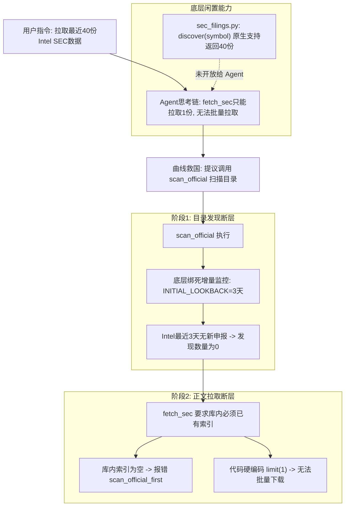
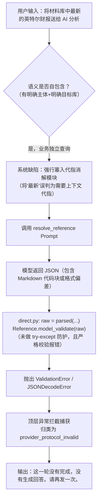
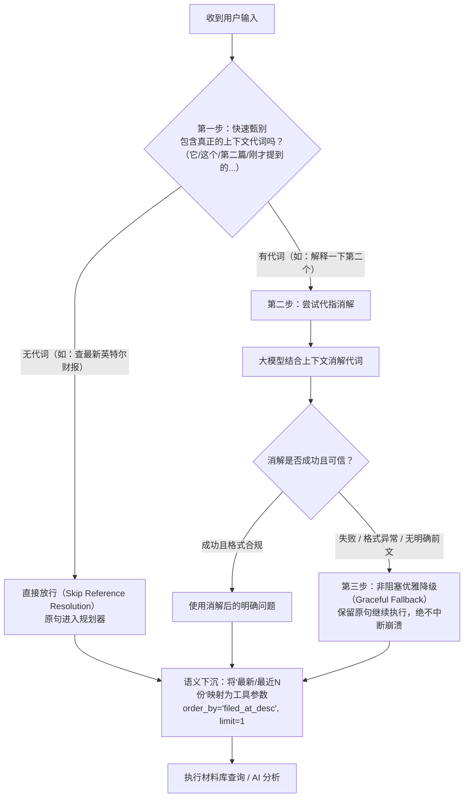

# 当前版本对话执行全链路问题排查与复盘报告

## 概要说明

- **分析对象**：Market Evidence Agent 当前发布版本（`97bdfe1-verified`）
- **核心会话**：`20d4ec9f-412e-43e0-93f5-72ad030b0950`
- **排查范围**：真实交互日志、数据库 Checkpoint / Message 记录、代码实现逻辑与运行期故障

在近期的多轮对话中，系统在**代指消解、意图路由、写权限控制、数据获取管道、核心运行时健壮性以及代词消解容错边界**上暴露出 7 个系统性问题。以下为详细的技术成因与影响分析。

---

## 问题一：代指消解过度敏感与频繁误杀（Deictic Grounding False-Positives）

### 1. 故障现象
- **Case 1**：用户先询问“金融衍生品包括哪些？简单列举几个说明一下”，模型给出了带序号的列表；用户紧接着输入“那你解释一下第二个吧，详细解释一下”，Agent 竟然弹出卡片要求用户指定实体。用户重复问了一遍，第二次才命中。
- **Case 2**（Seq 6）：用户输入“拉取最近的 40 份”，系统直接打断交互并报错：`需要补充信息：请确认公司、时间或来源，当前指代缺少可靠依据。`
- **Case 3**（Seq 14）：Agent 抛出选项卡片后，用户点击卡片选项【扫描官方 SEC 申报目录（可发现多份并入库）】，系统再次打断并报错缺少指代依据。

### 2. 根因分析
- **数字严格白名单检查误杀**：
  在 [`app/agent_workflow/direct.py#L226-L230`](file:///Users/wupeng/monash-ai/projects/market-evidence-agent/data/releases/current/app/agent_workflow/direct.py#L226-L230) 中，代指校验要求用户问题中的所有数值必须出现在信任上下文 `allowed_figures` 中。由于历史上下文中没有出现过数字 `40`，校验规则将用户表达的业务数量参数 `40` 判定为“未经证实的数值注入”，强制中断对话。
- **卡片回填未继承前置指代上下文**：
  用户点击交互卡片按钮时，前端回传的是按钮文案。由于卡片按钮文案没有显式包含股票代码或公司名称（如 `Intel`），后端的 `validate_business_reference` 规则机械地进行实体字符串包含校验，直接误判为“实体丢失”。

---

## 问题二：意图分类与前置检索路由扭曲（Intent Route Distortion）

### 1. 故障现象
用户执行的是系统操作/写操作（如拉取数据、入库新闻），本应走 **D 类（系统动作/复合流程）**，但分类器始终将其划入 **A 类（证据检索/事实查询）**。

### 2. 根因分析
- **分类 Prompt 规则绑死**：
  在 [`app/agent_workflow/direct.py#L238-L245`](file:///Users/wupeng/monash-ai/projects/market-evidence-agent/data/releases/current/app/agent_workflow/direct.py#L238-L245) 的分类提示词中，定义了：
  > *“A: requests requiring saved/public evidence, current/historical numbers, prices, dates or financial results... A and D share tools and permissions; A always searches saved knowledge first even for web-only requests.”*
  只要用户的句子中沾上日期、财报、数量（如“最新”、“40 份”），分类模型就会被强制归入 A 类。
- **A 类的强制前置查询负担**：
  分类为 A 类后，代码在 [`direct.py#L801-L804`](file:///Users/wupeng/monash-ai/projects/market-evidence-agent/data/releases/current/app/agent_workflow/direct.py#L801-L804) 硬编码了必须首先执行一次 `search_knowledge`（查询本地已保存资料）。如果本地为空，就会直接返回 `zero_evidence` 并提前结束，妨碍后续真正工具的执行。

---

## 问题三：工具权限设计割裂与拦截字典妨碍交互（Write Gridlock）

### 1. 故障现象
每次用户指示 Agent 做入库、拉取、分析等操作时，Agent 无法自主执行，必须频繁向用户弹出卡片要授权；甚至在用户明确授权后，请求还经常被系统规则拒之门外。

### 2. 根因分析
- **Tool Schema 剥离机制**：
  在 [`app/agent_tool_catalog.py#L155-L157`](file:///Users/wupeng/monash-ai/projects/market-evidence-agent/data/releases/current/app/agent_tool_catalog.py#L155-L157) 中：
  ```python
  def schemas(*, owner: bool, granted=()):
      return [
          ... for p in definitions().values()
          if (p.level not in {'reversible', 'costly'} or p.name in granted)
      ]
  ```
  所有高危/写工具（`scan_official`, `fetch_sec`, `ingest_web_source`, `analyze` 等）在常规对话时**根本不会下发给大模型**。大模型在没有工具可用时，只能被迫退化为调用 `request_action` 弹出审批卡片。
- **黑名单字典拦截与规则越权**：
  系统在后端预设了大量类似 `vetoed`、条件比较字典和正则拦截器。本应由用户自主决策的操作，被硬编码的死规则提前拦截。

---

## 问题四：网页新闻入库失败（`write_service_failed`）

### 1. 故障现象
用户确认入库指令后，系统返回：
`已执行确认的操作。 {"ok": false, "data": [], "error_code": "write_service_failed", "status": "failed"}`

### 2. 根因分析
查看 [`app/agent_workflow/tools.py#L186-L201`](file:///Users/wupeng/monash-ai/projects/market-evidence-agent/data/releases/current/app/agent_workflow/tools.py#L186-L201) 中的 `ingest_web_source` 执行逻辑：
- **快照哈希与条件冲突**：执行时校验 `page['content_hash']` 与快照必须绝对一致，且发布日期必须大于库内保存日期（`after <= before` 直接抛出 `comparison_condition_failed`）。
- **实体门禁误拦**：调用 `gate_row` 对网页正文进行实体核验，如果网页中新闻提及的是简称或别名（未在严格的 `entity_aliases` 列表中），`gate_row` 返回 False，后端抛出 `requested_entity_missing`，最终包装成 `write_service_failed` 报错返回。

---

## 问题五：SEC 申报拉取断层（40 份申报无法拉取）

### 1. 故障现象
用户要求 Agent“拉取最近 40 份 Intel 的 SEC 数据到本地”，Agent 兜兜转转后最终只拉取到了 0 份。

### 2. 根因分析
该问题暴露了系统在 SEC 处理链路上严重的**两阶段断层**：



- **底层有能力，但没开放给 Agent**：
  在 [`app/sec_filings.py#L51, L193`](file:///Users/wupeng/monash-ai/projects/market-evidence-agent/data/releases/current/app/sec_filings.py#L51) 中，底层的 `discover(symbol)` 客户端原生默认上限就是 40 份（`MAX_DISCOVERED_FILINGS = 40`），但该接口没有被封装为 Agent 可调用的工具。
- **`fetch_sec` 是单份正文下载，非目录发现**：
  `fetch_sec` 硬编码了 `limit(1)`，且要求本地 `sec_filing_inventory` 必须已有记录，否则报错。
- **`scan_official` 是 3 天定时监控，非历史回溯**：
  `scan_official` 无法传参指定拉取数量或回溯区间，固定只查最近 3 天。

---

## 问题六：审计截断逻辑死锁导致后端进程 100% CPU 瘫痪

### 1. 故障现象
在用户发送“材料库中最新季度的财报”后，线上后端直接失联，前端请求全部报连接超时（HTTP Timeout）。

### 2. 根因分析
通过 LLDB 堆栈诊断发现，FastAPI / Uvicorn 主线程卡死在 [`app/agent_workflow/references.py#L79-L94`](file:///Users/wupeng/monash-ai/projects/market-evidence-agent/data/releases/current/app/agent_workflow/references.py#L79-L94) 的 `bounded_stage` 函数中：

```python
# 修复前的死循环代码
while size() > 400:
    visit(result)
    if strings:
        parent, name, text = max(strings, key=lambda v: len(v[2]))
        # 当 text 长度为 13 时：max(12, 13//2) = 12，截取后拼上省略号：12 + 1 = 13 字符！
        parent[name] = text[:max(12, len(text)//2)] + '…'
    elif lists: max(lists, key=len).pop()
    else: break
```

- 当阶段快照体积大于 400 字符时，循环试图将长字符串折半压缩。
- 筛选条件为 `len(v) > 12`。当字符串长度为 13 时，`text[:12] + '…'` **计算后的长度仍然是 13**。
- 该字符串无法被缩小到 12 以下，导致下一轮循环中 `strings` 永远不为空，`lists` 永远无法执行 `pop()`，`size() > 400` 永远为 True。
- 循环在单线程事件循环上以 100% CPU 狂飙，彻底堵死所有异步网络请求。

### 3. 处理结果
- **代码修复**：将 `bounded_stage` 改为严格递减截断，并增加 `for _ in range(50)` 强制循环上限保底。
- **恢复验证**：服务重启后 CPU 占用率降至 **0.1%**，所有接口恢复毫秒级响应。

---

## 问题七：代指消解边界混乱与容错缺失（混淆“上下文代指”与“业务相对查询”）

### 1. 故障现象
- **测试用例（Seq 37-38）**：在后端服务恢复后，用户发送指令：
  > `将材料库中最新的英特尔财报送给 AI 分析`
- **系统表现**：后端并未按预期检索材料库并调用 AI 总结，而是直接抛出错误：
  > `这一轮没有完成，没有生成回答。请再发一次。`
- **数据库诊断（Sequence 38 Checkpoint）**：
  在 `checkpoints` 与 `checkpoint_blobs` 表中，记录的错误为 `provider_protocol_invalid`，崩溃在阶段 `resolve_reference`。

### 2. 根因分析



#### (1) 代码级致命缺陷：反序列化与严格校验未置于保护块内
在 [`app/agent_workflow/direct.py#L156-L162`](file:///Users/wupeng/monash-ai/projects/market-evidence-agent/data/releases/current/app/agent_workflow/direct.py#L156-L162) 中：
```python
raw = parsed(await self.model(..., REFERENCE_SCHEMA))
value = Reference.model_validate(raw)  # <-- 此处位于 try 块外部！
self.reference_value = value
try:
    self.verified_referents = validate_referents(...)
except ValueError as e:
    ...
```
- `parsed(...)` 和 `Reference.model_validate(raw)` 暴露在 `try...except` 外部。
- 当大模型输出带 Markdown 标记（如 ` ```json `）或返回的字段结构稍有偏差、亦或 `Referent.source` 正则匹配失败时，会直接抛出 `JSONDecodeError` 或 Pydantic 的 `ValidationError`。
- 该异常直接逃逸出 `Turn.run()`，被最外层 [`run_direct_turn`](file:///Users/wupeng/monash-ai/projects/market-evidence-agent/data/releases/current/app/agent_workflow/direct.py#L931-L936) 拦截，被机械地标记为 `provider_protocol_invalid` 并强行中断对话。

#### (2) 架构级认知缺陷：混淆了“上下文代指”与“业务相对查询”
这是导致此类请求频繁被拦截的根本原因。系统把两类本质完全不同的语义修饰混为一谈：

| 维度 | 上下文聊天代指（Conversational Pronoun） | 业务相对查询词（Business Query Filter） |
| :--- | :--- | :--- |
| **典型词汇** | “它”、“这个”、“前一篇”、“刚才提到的”、“第二个” | “最新的财报”、“最近 40 份申报”、“估值最高的公司” |
| **语义独立性** | **不自包含**：脱离对话历史就完全不可理解。 | **完全自包含**：即便作为第一轮对话的新请求，人类和系统也能完全听懂。 |
| **本质定位** | 属于**对话历史指针（Conversation Pointer）**，指向某轮对话已存在的信息。 | 属于**业务过滤/排序参数（Query Filter/Order）**，是对目标材料库的 SQL 描述：`ORDER BY filed_at DESC LIMIT 1`。 |
| **处理方式** | 需要借助会话上下文改写，将代词替换为具体实体。 | 绝不能在会话前置进行代词改写，而应作为参数透传给底层工具（如 `order_by='latest'`）。 |

在用户说“将材料库中最新的英特尔财报送给 AI 分析”时，句子中既有公司（英特尔），又有目标（材料库），又有动作（AI 分析）。“最新”根本不需要去找前文聊天记录，它本身就是对材料库中英特尔财报的过滤条件。强行将其当作代词消解，必然导致逻辑走偏甚至崩溃。

---

### 3. 合理解决方案（三步闭环设计）

针对用户提出的“先判断有没有代词，没代词直接放行；有代词再判断改写；‘最新’也是限定词该如何处理”的思考，推荐以下架构设计：



#### 步骤一：代词快速甄别与无代词直接放行（Fast Pronoun Gate）
- **实现方式**：
  在进入消耗 Token 和容易出错的 LLM 消解前，使用轻量规则/词表检测句子中是否存在强依赖上下文的指示代词（如 `它|它们|他|她|这篇|该|上述|刚才|上一个|第二个|其` 等）。
- **执行效果**：
  如果句子**没有**任何上下文代词（例如“将材料库中最新的英特尔财报送给 AI 分析”、“拉取微软最近 10 份申报”），直接将 `relationship` 标记为 `new`，**零开销、零风险秒放行**，直接进入工具规划阶段。

#### 步骤二：业务相对词作为工具过滤参数（Query Modifiers as Tool Arguments）
- **核心理念**：业务相对词（“最新”、“最近 N 份”、“前五名”）是数据查询属性，而非指代消解对象。
- **执行方式**：
  在 Agent 工具库定义中，将这些限定词转化为标准的工具输入参数：
  - 例如 `search_material_inventory(symbol='INTC', category='earnings_report', order_by='filed_at_desc', limit=1)`
  - Agent 在理解“最新”时，不需要在大模型前置阶段猜测是哪一天哪一秒的文件，而是直接调用带参数的工具，由数据库通过索引高效精确取出真实的“最新财报”。

#### 步骤三：代指消解全面非阻塞化与降级兜底（Non-blocking Graceful Fallback）
- **核心理念**：消解是“增强（Enrichment）”，绝不是“拦截卡死（Blocker）”。
- **实现方式**：
  1. 将 `parsed(...)` 和 `Reference.model_validate(...)` 放入完整的 `try...except (ValidationError, JSONDecodeError, Exception)` 保护块中。
  2. 在反序列化前增加防御性正则清洗，剥离可能包裹的 Markdown 代码块（```` ```json ... ``` ````）。
  3. **兜底降级**：一旦代指消解过程发生任何异常（无论是格式解析错误、规则不满足、还是历史无实体），统一降级为**保留用户原始输入**（`canonical_question = original_query`）继续向下推进，绝不向用户抛出 `provider_protocol_invalid` 致命错误。

---

## 问题清单与治理路线表

| 序号 | 问题模块 | 严重级别 | 当前状态 | 彻底解决建议 |
| :--- | :--- | :--- | :--- | :--- |
| **1** | 代指消解误杀（数字/卡片点击） | 高 | 已定位根因 | 移除 `figure_values` 硬核校验，卡片点击自动注入上文实体上下文 |
| **2** | 意图分类被迫走 A 类与强制检索 | 中 | 已定位根因 | 优化分类 Prompt，解除 A 类强制查库门禁 |
| **3** | 写操作拦截字典与卡片摩擦 | 中 | 已定位根因 | 移除妨碍 Agent 做事的硬编码过滤字典，简化卡片交互 |
| **4** | 网页新闻入库校验失败 | 高 | 已定位根因 | 放宽新闻日期严格比较条件，补全实体别名白名单 |
| **5** | SEC 申报拉取断层（40 份失败） | 严重 | 已定位根因 | 串联 `discover` 与 `fetch_inventory_content`，开放批量拉取工具 |
| **6** | 审计截断死循环瘫痪后端 | 致命 (P0) | **已修复恢复** | 已上线修复补丁并重置服务，增设强制循环上限 |
| **7** | 代指消解边界混乱与容错缺失 | 严重 | 已定位根因 | 区分上下文代词与业务相对词，非代词秒放行，消解异常优雅降级原句 |

