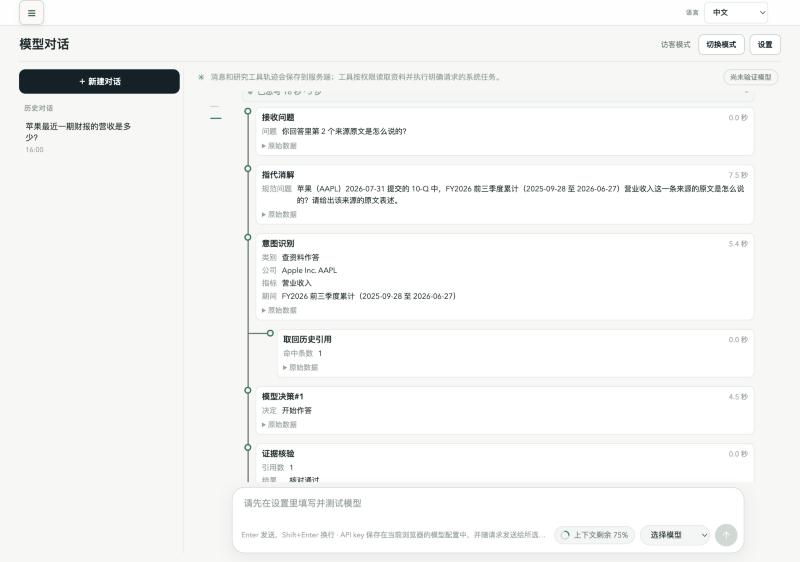
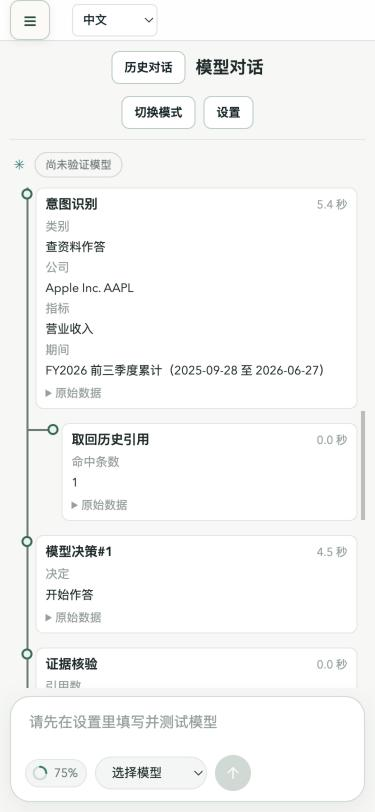

# G9 验收遗留修复：最终验收报告

日期：2026-10-24。分支 `g10-acceptance-fixes`（起点 main `5225855`）。验收标准见 `docs/superpowers/plans/2026-10-24-g9-acceptance-fixes.zh-CN.md`。

**最终结论：通过。** 全部验收项都在最终代码 `facfe89` 上达标：
- 真实模型专项：S1 6/6、S2 6/6、S3 6/6；
- 回归：指代老用例 12/12 组，多轮对话用例 56/58 轮；
- 全量测试的失败集合与 main 同一天的基线完全一致；
- 界面 C1–C3 全部通过。

本报告是用户授权“由 Claude 接着做完”之后，在最终代码（`facfe89`，再加本报告所在的提交）上重新完整跑出的结果。之前各轮的结论都保留，没有覆盖：
- GPT 第一次独立验收：未通过（S1 1/6、S2 2/6、S3 3/6，suite-v2 51/58）。原文存档在 [initial-review](2026-10-24-g9-acceptance-fixes-initial-review.md)。
- GPT 继续修复期间的 V1–V4 诊断跑：过程和 Rulings 记在 `/tmp/market-g10/ledger.md`。

成绩一律按当轮整套计算，不跨轮挑最好成绩拼凑。

## 修改内容

| 提交 | 内容 |
|---|---|
| `2ddfda9` | Task 1/2：删除用正则在用户原话里找 `[n]` 的拦截。改由指代消解输出 `history_citations`（answers_back + ordinal），服务端只负责把它映射到允许清单里的句柄，映射不上的拒绝并记审计。`agent_loop` 开头先按绑定回查，只要有一个来源读取成功，就跳过 A 路由的必查检索。派生引用改读它在允许清单里的父来源。 |
| `404aa0a` | Task 3/4：流程图主线和分支线改为 2px、颜色用 `--c-muted`；错误码通过 `CODE_LABELS` 显示成文字，原始数据里保留原码。 |
| `11cfc30` | GPT 第一次独立验收的报告和证据（结论：未通过）。 |
| `260fb3e` | 引号内的多句引文、Markdown 块引用，段末的来源覆盖整段，不再被拆开判成缺引用。数字和事实仍逐项核对。 |
| `1b37f17` | 澄清时由模型在 `clarification_answers` 里选出候选回答的位置，服务端用目录里原始的回答开头生成选项。已经验证过的页面操作回执，允许进入受限修复。 |
| `3241267` | 回查原文的回答，引完原文就结束；修复时，被标记的额外提议直接删掉，不再保留。 |
| `778c9d6` | 来源标题里的方括号数字（例如新闻标题里的“[2026]”），只要标题是服务端已知的，就当普通文字处理；块引用段末的来源判断同样如此。未知的编号仍判为无效，标题本身也不能充当引用。 |
| `facfe89` | 提示词写明“工具说明不是证据，[n] 只能指本轮工具结果的编号”。此前模型会给没有证据的产品流程说明标上 [1]，导致整段被判为无效引用而删光（多轮对话用例 S11.2 在本分支 2/2 失败，在 main 上 0/2 失败）。 |

以下内容没有改动：64 KiB 预算及 32/24/8 的分配、窗口计量、`read_history_citation` 的允许清单和来源复核、写操作授权、身份校验。

## A. 自动测试

同一天，用同一条命令，分别在未改动的 main（`5225855`）和本分支的最终代码上跑全量：

```sh
PATH=/Users/wupeng/.nvm/versions/node/v20.20.2/bin:$PATH PUBLIC_API_MODE=false RAG_ENABLED=false RAG_INDEXING_ENABLED=false PYTHONPATH=. /Users/wupeng/monash-ai/projects/market-evidence-agent/.venv-rag/bin/python -m pytest -q -p no:cacheprovider -W ignore
```

| 代码 | 通过 | 失败 | 跳过 | 日志 |
|---|---:|---:|---:|---|
| main `5225855` | 1628 | 9 | 7 | `/tmp/market-g10/logs/claude-full-market-g9-verify.log` |
| 本分支 `778c9d6` | 1662 | 10 | 7 | `/tmp/market-g10/logs/claude-full-market-g10.log` |
| 本分支最终 `facfe89` | 1663 | 9 | 7 | 失败集合与 main 完全相同 |

- 两边共有 9 个失败，都在改动前就存在。其中 8 个测试写死了日期，过期即失败：5 个 `test_forecast_publication_v2.py`，以及 `test_forecast_worker_v2.py`、`test_agent_forecast_price_writes.py`、`test_agent_revision_picker.py`。另 1 个 `test_api_server_launchagent.py` 依赖运行环境。
- 本分支多出 1 个失败：`test_material_sync_acceptance.py::test_sec_sync_cycles_cover_both_sides_of_the_initial_source_and_updates`。在本分支单独连跑 3 次都通过；GPT 同一天在未改动的 main 上也遇到过它失败（`reviewer-baseline.log`）。判为不稳定测试，不是本次引入的。
- 定向测试 108 个全部通过，覆盖：引用标题、引用块、修复、历史引用、指代、规范问题、数字依据。
- 前端：`npm run test:i18n` 102 个全部通过，`npm run build` 成功。

## B. 真实模型

**环境：** 影子 API 跑本分支的最终代码，端口 9038，用 `reviewer-shadow.py` 启动（加载主仓库 `.env` 的完整配置），连影子库 `test_g6_shadow_20261019`（启动时断言库名），默认 64 KiB 预算。模型是 Token Plan 的 `deepseek-v4.1-flash-1017`，密钥只读进内存，没有写进任何产物。

**跑法：** 每个场景 owner、guest 各跑 3 次，每次新开会话。判定依据是库里存下的 trace、审计中的实际 reads 参数和澄清卡，脚本是 GPT 的 `scenarios-v4.py`，只改了输出目录。

| 场景 | owner | guest | 合计 | 门槛 | 结论 | 最后一轮思考时间中位数 |
|---|---:|---:|---:|---:|---|---:|
最终代码 `facfe89` 的整套结果（`natural-acceptance-claude-final3/`）：

| 场景 | owner | guest | 合计 | 门槛 | 结论 | 最后一轮思考时间中位数 |
|---|---:|---:|---:|---:|---|---:|
| S1 按标记回查 | 3/3 | 3/3 | **6/6** | ≥ 5/6 | 通过 | 17.5 s（修复前同类追问 34–35 s） |
| S2 明确指定更早的回答 | 3/3 | 3/3 | **6/6** | ≥ 5/6 | 通过 | 19.1 s |
| S3 只说编号且有歧义 | 3/3 | 3/3 | **6/6** | ≥ 5/6 | 通过 | 5.6 s（以澄清卡结束） |

- **S4（只记录）：** 追问计算引用 [11]。服务端没有读 [11] 本身，而是读了它的两个父来源 [1] 和 [3]；模型用 `calculate` 重算并标上本轮的新编号，最终 succeeded（`derived-claude-final3.json`）。

### 回归（最终代码 `facfe89`）

| 套件 | 本轮 | 上一轮记录（2026-10-22） | 结论 |
|---|---|---|---|
| canonical-time，重复 3 次 | **12/12 组，15/15 轮** | 11/12 组，14/15 轮 | 达标 |
| suite-v2 | **19/21 组，56/58 轮** | 18/21 组，55/58 轮 | 达标 |

suite-v2 剩下的两个失败，都是核验器原有规则的拒绝，这一轮没有改动相关代码：
- **S01.3**：表格前的一句引导语（“两个数字都来自同一份 2026-07-29 提交的 10-K……中的 XBRL 披露值：”）带了申报信息，却没有标 [n]，判为缺引用；修复一轮后仍未通过。
- **S21.2**：回答引用了 META 原文句子 “Total revenue for 2025 was $200.97 billion…”，但在所引来源 [2] 的摘录里找不到 2009.7 亿这个数，判为数字对不上。GPT 第一次验收时这个用例也失败过。

### 过程（不跨轮拼成绩）

1. **`778c9d6` 整套（final2）**：S1 5/6、S2 6/6、S3 6/6。S1 唯一的失败是第一问只标了 [1]，追问“第 2 个来源”的前提不成立。canonical 11/12 组（T04 第 3 次把“去年”误判成 FY2026）。suite-v2 **52/58，未达标**。
2. **同日对照**：S05、S07、S11、S20 在 main（线上代码）和本分支上各跑 2 次。main 19/20 轮，本分支 17/20 轮。S05、S20 在本分支全部通过，说明是当天新闻内容带来的波动；**S11.2 在本分支 2/2 失败、在 main 上 0/2 失败**，确认是回归。原因：模型给没有证据的产品流程说明标上了 [1]。
3. **修复 `facfe89`**，再单独跑 S11 三次：S11.2 3/3 通过。
4. **在 `facfe89` 上从头整套重跑（final3）**，即上面两张表的结果。

## C. 界面（最终代码，影子 API + Vite，浏览器实测）

1. **流程图顺序：** 用一个访客会话，先问“苹果最近一期财报的营收是多少？”，再问“你回答里第 2 个来源原文是怎么说的？”。第二轮的图依次为：接收问题 → 指代消解 → 意图识别 → **取回历史引用**（挂在意图识别下）→ 模型决策#1 → 证据核验 → 输出回答。这一轮用了 17.5 秒，没有重新检索。修复前，同样的追问要先跑必查检索、再重新检索，耗时 34–35 秒。
2. **连线（1280px）：** 用 `getComputedStyle` 量 `.flow-node::before`：宽 `2px`，颜色 `rgb(106, 121, 119)`，所在背景 `rgb(247, 248, 246)`。按相对亮度公式算出对比度 **4.27:1**，满足 ≥ 3:1。
3. **375px：** `document.documentElement.scrollWidth = clientWidth = 375`，流程图容器没有横向溢出。
4. **错误码：** 取一条存下的核验节点，`issues: ["missing_citation"]`，交给前端的 `describeOutput()` 渲染，显示为“未核对上：缺少引用标记”（`translate: true`）。原始码只出现在“原始数据”里。





## D. 文档

- `docs/agent-context.md`：已写明指代消解负责绑定引用、服务端先回查以替代必查检索、不用正则拦截；另外补充了澄清候选的生成方式，以及引文、块引用的核验范围。
- `docs/reports/2026-10-22-history-citation-on-demand-acceptance.md`：已更新为 G9 合并发布后的状态，原来“未通过”的结论移入历史记录保留。

## Rulings

1. 本轮第一次跑 S1–S3 时，影子服务用的是 `/tmp/market-g10/e2e/g10-shadow.py`。这个脚本只读数据库地址，不加载 SEC 身份等配置，结果 18 组的第一问全部停在“请确认这次指代的公司”，场景根本没有开始。这是环境配错，不算功能失败。原结果保留在 `natural-acceptance-claude-final/`；之后换用 `reviewer-shadow.py` 整套重跑，结果在 `natural-acceptance-claude-final2/`。
2. GPT 在 9038 端口遗留了一个 15:45 启动的影子服务，加载的是 `778c9d6` 之前的代码，拿它验收测不到最终代码，因此先停掉它，再用最终代码重新启动。
3. final2 的 suite-v2 没达标。先用同日对照找出确定的回归（S11.2），修复后在新代码上把专项和两套回归从头整套重跑，没有沿用修复前的任何成绩。

## 证据

- 真实模型（最终）：`/tmp/market-g10/continued/natural-acceptance-claude-final3/`、`derived-claude-final3.json`、`canonical-claude2/`、`suite-claude2/`
- 真实模型（过程）：`natural-acceptance-claude-final/`（环境配错，无效）、`natural-acceptance-claude-final2/`、`canonical-claude/`、`suite-claude/`、`ab-main/`、`ab-final/`、`s11-fix/`、`logs/claude-*.log`
- 全量测试：`/tmp/market-g10/logs/claude-full-*.log`
- GPT 各轮：`/tmp/market-g10/ledger.md`、[完整证据索引](2026-10-24-g9-acceptance-fixes-assets/evidence-index.txt)

## 附记：日期敏感测试修复（2026-10-24，main）

验收后复核发现，A 节所称“8 个测试写死了日期”只对其中 6 个成立；另外 2 个用的是相对日期，但恰好落在非 XNYS 交易日。已在 main `f58cecc` 上直接修复测试，生产代码未改，提交 `4df085d`。

- 5 个 `test_forecast_publication_v2.py` 和 1 个 `test_forecast_worker_v2.py` 把 anchor 固定为 `2026-09-23`，20 个交易日后 target 在 2026-10-24 已经过期；改为 `latest_completed_xnys_session(instant - 1 分钟)`。
- `test_agent_forecast_price_writes.py` 的 `target_end = now.date() + 120 天` 不保证是交易日。`_require_open_target` 会先抛 invalid target contract，把期望的 `revision_source_symbol_mismatch` 覆盖成 `forecast_version_not_revisable`；改为 `future_xnys_sessions(latest_completed_xnys_session(now), 20)[-1]`。
- `test_agent_revision_picker.py` 的过期用例用 `date.today() - 20 天`，同样可能不是交易日，实际得到 `version_not_revisable` 而不是 `target_expired`；改为 `latest_completed_xnys_session(now - 20 天)`。
- 定向复跑 4 个文件：34 passed。全量：1 failed, 1671 passed, 7 skipped；唯一失败是 `test_api_server_launchagent.py::test_fresh_checkout_uses_rag_environment_only_when_enabled`，属于部署脚本允许的环境失败。
- 仓库的 GitHub issue、PR 和文档里都没有找到“修复写死日期的测试”任务卡片；本次修复以本附记和提交 `4df085d` 为记录。

