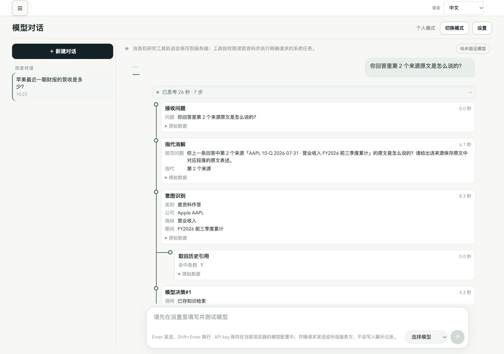
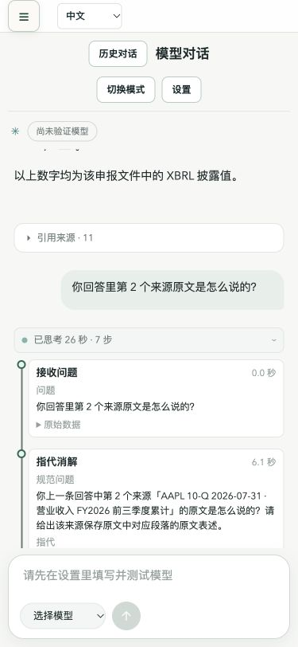
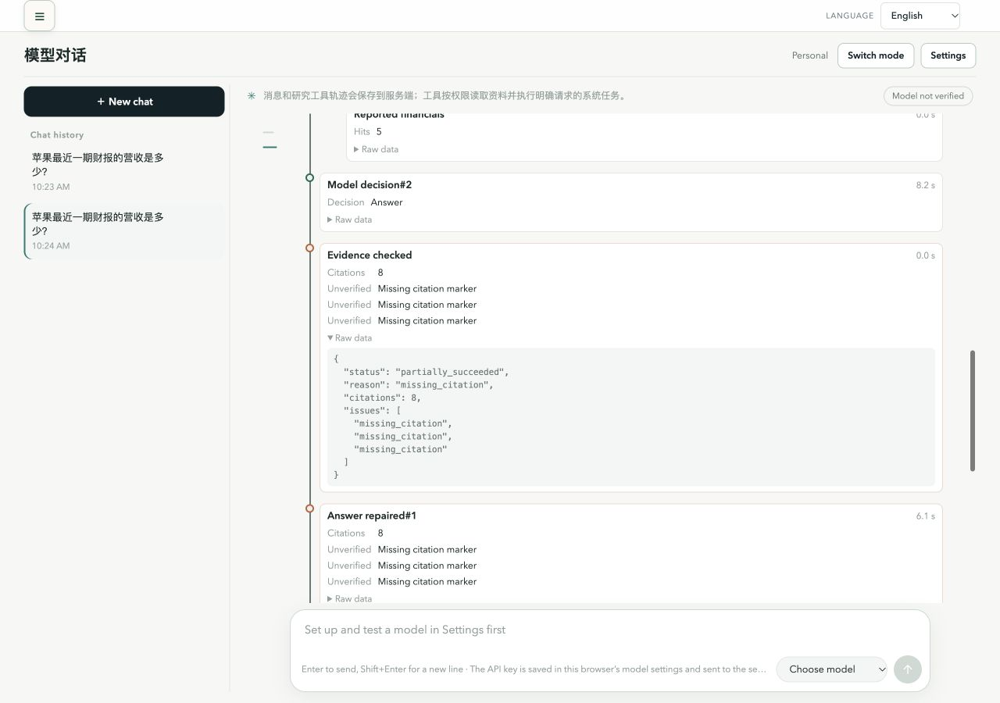

# G9 验收遗留修复：G10 独立验收报告

日期：2026-10-24。**最终结论：未通过，不作为合并或发布通过的依据。**

代码已在 `/tmp/market-g10/worktree` 的 `g10-acceptance-fixes` 分支实现并本地提交，起点为 `52258551e1c2807f5b1f2067b36337b5d15ee828`。未推送、未合并、未部署。主仓库 main 的受版本控制文件保持原状。

## 实现与范围

- Task 1：删除历史引用意图的正则拦截，增加有界 `HistoryCitationRef` 与模型引用目录；服务端只把模型选择映射到允许句柄，拒绝不存在的绑定。批准后恢复路径初始化空绑定。
- Task 2：A/D 工具循环先回查绑定；至少一个来源成功接受时替代 A 路由强制检索。派生引用改读同答复允许的父来源，回查失败仍走原检索。审计额外保存实际 `reads` 参数用于独立验收。
- Task 3：主线和分支线为 2px，使用页面变量 `--c-muted`，保留 reduced-motion。
- Task 4：增加 CODE_LABELS，已知错误逐项翻译，未知码原样保留，原始数据不变；同时更新两个语言文件和声明。
- Task 5：更新上下文说明、历史报告状态，并保存本报告与截图。预算 64 KiB / 32-24-8 分配、计量、历史读取工具校验和写授权均未修改。

实际交付代码提交：`2ddfda9`（Task 1/2）和 `404aa0a`（Task 3/4）。文档提交见本分支 git log。worker 曾在辅助副本生成的提交不是本分支交付提交。

## A. 自动测试与同日基线

| 执行 | 通过 | 失败 | 跳过 | 说明 |
|---|---:|---:|---:|---|
| 未修改 worktree，HEAD 5225855，主模型首轮 | 1627 | 10 | 7 | 正式比较基线 |
| 未修改 main，主模型同日复跑 | 1628 | 9 | 7 | SEC sync 此次通过 |
| 最终交付代码，主模型独立全量 | 1634 | 10 | 7 | 与首轮失败集合完全相同，无新增失败，退出码 1 |
| 最终 worker 受限环境自测 | 1636 | 8 | 7 | API launchagent 和 SEC sync 此次通过；保留为不同环境结果 |

全量命令（首轮与最终独立执行使用同一 worktree 路径、同一 Python 和环境）：

```sh
cd /tmp/market-g10/worktree
PATH=/Users/wupeng/.nvm/versions/node/v20.20.2/bin:$PATH PUBLIC_API_MODE=false RAG_ENABLED=false RAG_INDEXING_ENABLED=false PYTHONPATH=. /Users/wupeng/monash-ai/projects/market-evidence-agent/.venv-rag/bin/python -m pytest -q -p no:cacheprovider -W ignore
```

两个正式比较集合如下，最终集合与首轮完全一致；同日复跑 main 的集合少 SEC sync 一项。没有修改这些失败测试：

| 测试 ID | 首轮基线 | 最终独立全量 |
|---|---|---|
| `tests/test_agent_forecast_price_writes.py::test_a_revision_source_from_another_symbol_keeps_its_own_reason` | failed | failed |
| `tests/test_agent_revision_picker.py::test_an_expired_forecast_is_explained` | failed | failed |
| `tests/test_api_server_launchagent.py::test_fresh_checkout_uses_rag_environment_only_when_enabled` | failed | failed |
| `tests/test_forecast_publication_v2.py::test_automatic_revision_window_is_measured_from_root_decision_time` | failed | failed |
| `tests/test_forecast_publication_v2.py::test_changed_target_is_rejected_without_publishing_a_child` | failed | failed |
| `tests/test_forecast_publication_v2.py::test_experimental_jev_publishes_only_decision_probabilities_with_brief_and_matching_cutoffs` | failed | failed |
| `tests/test_forecast_publication_v2.py::test_root_and_branch_publish_atomically_without_changing_parent` | failed | failed |
| `tests/test_forecast_publication_v2.py::test_same_root_and_same_effective_input_returns_existing_version` | failed | failed |
| `tests/test_forecast_worker_v2.py::test_worker_injected_processor_publishes_one_research_only_version` | failed | failed |
| `tests/test_material_sync_acceptance.py::test_sec_sync_cycles_cover_both_sides_of_the_initial_source_and_updates` | failed | failed |

A2 按首轮正式基线比较通过；不能把全量说成全绿。对比 JSON：`/tmp/market-g10/logs/reviewer-failure-comparison.json`。worker 报告曾以其 8 项结果判 A2 不一致，本报告以主模型同环境的两次正式命令结果为最终结论。

前端主模型在最终代码上原样执行 `npm run test:i18n`：**102 passed / 0 failed**；`npm run build` 成功（原有大 chunk 提示仍在）。受限 worker 的共享 node_modules 临时配置 EPERM 属于执行环境记录，已由 host 原样构建通过验证。主模型另外独立跑过相关后端定向组 32 passed，最终全量包含全部新增测试。

**测试时序偏差：**首轮 worker 先改实现再补测试，随后在 pristine 5225855 副本取得 8 failed / 11 passed 的 RED 证据；这不是按时间顺序的“先写失败测试再实现”，不能伪称满足。一次集中修正遵守了 RED/GREEN：prompt 断言 1 failed 后 3 passed，实际 reads 审计断言 2 failed 后 2 passed，前端多错误映射 RED 后 12 passed。A1 的新增功能断言通过，但最初测试时序要求未满足，已记 Ruling。

## B. 真实模型专项

最终影子 API 使用本工作区、9038、断言影子库 `test_g6_shadow_20261019`、默认 64 KiB，模型为 Token Plan `deepseek-v4.1-flash-1017`。密钥只读入内存，没有写入产物。每项 owner / guest 各 3 次，每次新会话。判定读取 DB 的 trace、clarification 和 `audit.history_citation_recall.reads`，与实际工具事件核对；不以回答措辞代替。

18 次最终专项均对应交付的 direct.py SHA-256 `b1e79bd993af244393eac03526bb075e62c1b6feba348352474e0bf3fe866bac`。

| 场景 | owner | guest | 总计 | 门槛 | 结论 |
|---|---:|---:|---:|---:|---|
| S1 | 1/3 | 0/3 | 1/6 | 至少 5/6 | 未通过 |
| S2 | 0/3 | 2/3 | 2/6 | 至少 5/6 | 未通过 |
| S3 | 2/3 | 1/3 | 3/6 | 至少 5/6 | 未通过 |

- **S1：**5/6 首个工具是历史引用读取且成功，只有 1/6 同时最终 succeeded。4 次多句 XBRL 原文引述被 `missing_citation` 删除，最终 partially_succeeded。另一次 guest 的 resolver 因 `reference_position_mismatch` 失败，绑定按要求清空，回到原检索，未先执行历史回查。
- **S2：**6/6 没有澄清卡，6/6 的 DB 实际回查参数都绑定第一轮的正确 turn_id / ordinal；4 次仍因引述句的 missing_citation 只部分完成，所以严格通过数为 2/6。
- **S3：**5/6 以澄清等待结束，6/6 没有执行历史引用读取，但只有 3/6 同时满足候选项包含第一条回答开头。owner-3 和 guest-1 只列“市盈率回答”和“另一个回答”，遗漏财报回答；guest-2 出现 resolver_clarify_deferred，最终未出卡。该次具体是哪项澄清有效性条件未满足未保存，不能进一步断言；后续无依据地选择较早来源且部分核验失败。
- **S4（仅记录）：**真实派生来源 11 的追问成功，DB reads 记录先取同一历史轮次的父项 1、3，不读派生项 11，随后 calculate，最终 succeeded。

S1 第二轮 thinking_ms 中位数为 **27.56 秒**；方案参考值为 34–35 秒。该轮专项与回归并行，参考值不是同负载对照，不能据此宣称性能提升比例。

剩余问题主要在模型输出与引用核验的衔接，以及模型澄清候选的完整性。现有答案/数字核验器未被放宽。S3 提示目前允许“最新回答 opening + 其他回答”的选项形式，没有可靠保证真实历史候选一定列出；这与观察到的遗漏一致，但没有做控制变量实验来证明因果。

首轮诊断结果在 reviewer-natural/；脚本最初把 DB 持久化状态 complete 误当作业务 succeeded，原始 summary 中的零分统计无效。最终脚本已改读 DB trace 末节点状态与实际 reads 参数；本报告只采用 **reviewer-natural-final/** 的完整一次结果，不拼接两轮最好成绩。

## B. 对话回归

| 套件 | 本轮 | 方案上一轮记录 | 结论 |
|---|---|---|
| canonical-time，重复 3 次 | 12/12 组，15/15 轮 | 11/12 组，14/15 轮 | 达标 |
| suite-v2 | 14/21 组，51/58 轮 | 18/21 组，55/58 轮 | 未达标 |

本轮 suite-v2 失败逐项如下；除 S02.2 外，都是相对方案给出的上一轮失败列表（S02.2、S07.1、S14.2）新出现的失败位置。这里记录可观察原因，单次真实模型运行不能证明其由本次代码修改造成。

| 用例 | 可观察原因 |
|---|---|
| S02.2 | “它的营业利润”在两家公司后被直接解析为微软，未按测试预期出澄清卡；与上一轮同一失败。 |
| S07.2 | 半个月新闻摘要被 unsupported_claim 拒绝并删去，未满足 nothing dropped。 |
| S08.3 | “回到刚才的概念”被规范为微软具体财年数据问题，分类 A；测试期望 B，实际继续检索与计算。 |
| S10.3 | 把差额换成十亿美元的公式表述被 unsupported_numeric_claim 拒绝，产生删除。 |
| S11.1 | 讨论保存流程时，“入库后不会自动更新/补抓”等说明被 unsupported_claim 拒绝；本轮没有实际写入工具。 |
| S15.4 | open_page 的回复额外带浏览器事件时间戳，数字核验以 unsupported_numeric_claim 判失败。 |
| S21.2 | META 原文与 AI 分析比较的多句表述被 missing_citation 拒绝，最终部分完成。 |

本轮 S07.1 和 S14.2 通过。游客自称所有者的写入拒绝、提案确认/取消等用例按各自检查通过；这不代替完整套件通过。原始脚本和 suite JSON 未改。

## C. 界面

- 使用自然 S1 会话的真实 API 恢复响应，在当前前端回放。回放桥仅暴露选中的只读响应，不伪造 trace，不代替浏览器身份认证测试。成功回查样本显示“意图识别 → 取回历史引用”；另一个实际部分完成样本用于验证错误显示。
- 1280×900、devicePixelRatio=1。getComputedStyle：主线宽 2px，分支宽 2px，颜色 `rgb(106,121,119)` / `#6a7977`，实际背景 `rgb(247,248,246)` / `#f7f8f6`，相对亮度公式计算对比度 **4.272:1**。
- 375px、devicePixelRatio=1：documentElement.scrollWidth = clientWidth = 375，无横向溢出。
- 卡片行显示“缺少引用标记”；切换英文后多条逐一显示“Missing citation marker”；展开 Raw data 后保留原始 missing_citation。







## D. 文档、证据与交付

- `docs/agent-context.md` 已补模型绑定、服务端提前回查替代强制检索、不用正则拦截三点。
- `docs/reports/2026-10-22-history-citation-on-demand-acceptance.md` 已更新 G9 的历史合并/发布和 8/8 复测记录，旧未通过结论完整保留在历史记录。
- 本报告为最终独立结论：A2、A3 和 C 的技术检查通过；A1 初始测试时序有偏差；B 的三个专项与通用回归未通过。整体未通过。

关键日志/结果：

- `/tmp/market-g10/logs/reviewer-baseline.log`、`reviewer-main-baseline-repeat.log`、`reviewer-backend-final.log`：三次正式全量命令日志。
- `/tmp/market-g10/logs/reviewer-failure-comparison.json`：完整失败集合与差集。
- `/tmp/market-g10/logs/reviewer-frontend-final-tests.log`、`reviewer-frontend-final-build.log`：102 测试与原样构建。
- `/tmp/market-g10/logs/correction-*-red.log` / `*-green.log`：集中修正的 RED/GREEN；`history-red-baseline.log` 为首轮追溯 RED。
- `/tmp/market-g10/e2e/reviewer-natural-final/`、`reviewer-derived-final.json`、`reviewer-ui-evidence.json`、`reviewer-final-evidence.json`：专项、DB 证据、派生回查、界面与汇总。
- `/tmp/market-g10/e2e/reviewer-canonical-final/results-20261024-103222.json`
- `/tmp/market-g10/e2e/reviewer-suite-final/results-20261024-103428.json`
- `/tmp/market-g10/logs/reviewer-canonical-final.log`、`reviewer-suite-final.log`：真实套件完整终端输出。
- `/tmp/market-g10/ledger.md`：过程与 Rulings。

全部日志、结果和支持脚本的绝对路径见 [完整证据索引](2026-10-24-g9-acceptance-fixes-assets/evidence-index.txt)。修正前 suite-v2 只作为被中止的诊断保留；最终套件完整跑完，没有用诊断成绩替代。

验证服务 9038、只读回放 9039、前端 5179/5180 均已停止，临时浏览器页数量为 0，viewport override 已 reset。未触碰生产服务。
