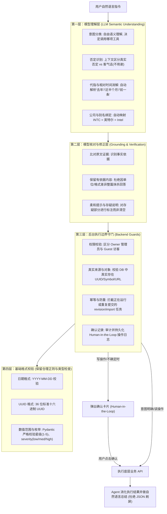
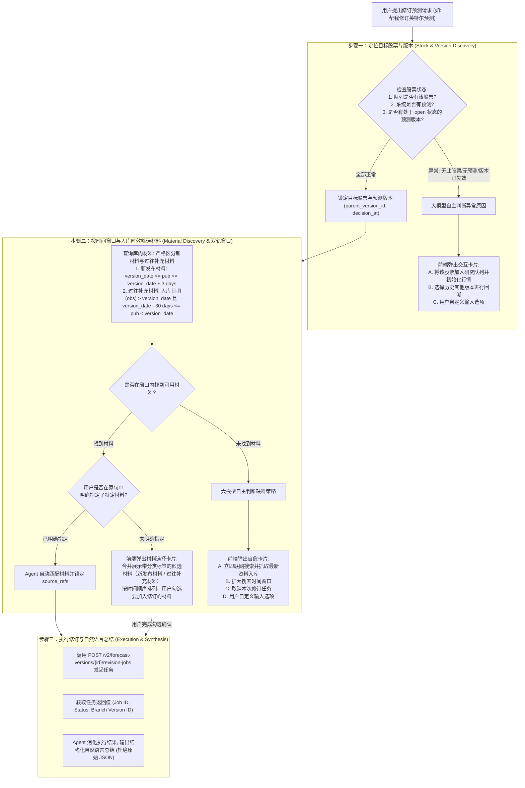

# 系统硬性拦截逻辑全盘审计与解绑报告
> **文件位置**：`docs/system_hardcoded_interception_audit.md`  
> **审计时间**：2026-10-17  
> **涉及核心模块**：`app/agent_workflow/direct.py`、`actions.py`、`authorization.py`、`evidence.py`、`references.py`、`tools.py`

---

## 目录
1. [背景与架构根因：为什么存在这些硬拦截？](#一背景与架构根因为什么存在这些硬拦截)
2. [六大硬性拦截门禁深度剖析](#二六大硬性拦截门禁深度剖析)
   - [拦截一：动词白名单与粗暴否定拦截（Actions & Authorization）](#拦截一动词白名单与粗暴否定拦截)
   - [拦截二：指代消解防伪拦截（Reference Period & Figures Unbound）](#拦截二指代消解防伪拦截)
   - [拦截三：回答审查与内容抹除（Reviewed Passages & Unsupported Numbers）](#拦截三回答审查与内容抹除)
   - [拦截四：检索证据过滤网（Evidence Gating / gate_row）](#拦截四检索证据过滤网)
   - [拦截五：入库时效严格不等式拦截（Web Ingest Date Comparison）](#拦截五入库时效严格不等式拦截)
   - [拦截六：上下文序号正则硬卡（Assistant Item Catalogue）](#拦截六上下文序号正则硬卡)
3. [功能权限断层对比矩阵（用户能做 vs Agent 被拦截）](#三功能权限断层对比矩阵)
4. [现代化演进与解绑建议](#四现代化演进与解绑建议)

---

## 一、背景与架构根因：为什么存在这些硬拦截？

在当前代码库的设计中，原作者贯彻了一种**“极度不信任大模型（LLM）”**的保守防御哲学。原作者认为大模型具有不可控的“幻觉（Hallucination）”与“过度热心（Over-eagerness）”，可能在用户无意的情况下擅自调用扣费接口、修改数据库或误解否定句。

因此，原作者在系统内设计了一套**“大模型 + 代码看门狗”的双重门禁体系**：

```mermaid
flowchart TD
    UserQuery["用户自然语言指令"] --> LLMClassifier["大模型意图分类与改写 (classify_intent / reference)"]
    LLMClassifier --> DogCheck{"代码看门狗 (actions.py / evidence.py / direct.py)"}
    
    subgraph 代码看门狗校验层 (纯代码/正则)
        DogCheck -->|"1. 扫描原始文本必须包含特定动词"| VerbGate["动词门禁: 只有 7 个写死动作"]
        DogCheck -->|"2. 比较改写后是否多出数字/年份"| PeriodGate["指代门禁: 多出一个字即弹窗打断"]
        DogCheck -->|"3. 网页内容是否包含指定英文/代码"| RowGate["证据门禁: 不合规直接丢弃搜索结果"]
        DogCheck -->|"4. 最终回答提取金额与数字逐字搜引文"| AnswerGate["审查门禁: 数字对不上整段抹除清空"]
    end
    
    VerbGate -->|未通过| ActionRejected["一票否决: 抹除执行权限, 回复拒绝"]
    PeriodGate -->|未通过| CardBlocked["强行阻断: 弹出卡片要求用户重新澄清"]
    RowGate -->|未通过| ZeroEvidence["返回 zero_evidence (声称未找到资料)"]
    AnswerGate -->|未通过| WipeAnswer["抹除大模型回复, 强制替换为套话"]
    
    DogCheck -->|全部通过| ExecutionCard["生成前端系统操作确认卡 (Human-in-the-loop)"]
```

> [!CAUTION]
> **代码注释摘录（原作者的设计信条）**：
> `app/agent_workflow/actions.py#L98-L100`：  
> *“Without a plain request there is no authority, whatever the intent model made of the sentence.”*  
> （无论意图大模型把用户的句子理解得多么充分，只要用户原话里没有出现代码认识的动词，系统就绝对不授予任何执行权限。）

**带来的恶果**：
人类自然语言表达是丰富多样的，但正则表达式和硬编码规则永远是有限的。这种“用 80 年代正则死抠现代大模型”的做法，导致系统处处是荆棘，用户正常交流频繁被误判、弹卡片打断或直接抹除回答。

---

## 二、六大硬性拦截门禁深度剖析

### 拦截一：动词白名单与粗暴否定拦截
* **涉及源码**：[`app/agent_workflow/actions.py#L51-L105`](file:///Users/wupeng/monash-ai/projects/market-evidence-agent/app/agent_workflow/actions.py#L51-L105)、[`app/agent_workflow/authorization.py#L5-L45`](file:///Users/wupeng/monash-ai/projects/market-evidence-agent/app/agent_workflow/authorization.py#L5-L45)
* **核心代码逻辑**：
  ```python
  def _requested_action_words(question: str) -> str | None:
      lower = question.lower()
      if re.search(r"(?:查看|查询|...).{0,12}(?:任务状态|...)", lower): return "status"
      if re.search(r"(?:刷新|...).{0,25}(?:原文|...)", lower): return "refresh_sec"
      if re.search(r"(?:抓取|获取|拉取|下载|...).{0,25}(?:原文|申报|财报...)", lower): return "fetch_sec"
      if re.search(r"(?:送给|送去|交由|让|进行|做个|生成|开始).{0,15}?(?:ai\s*分析|分析|解读|研报)", lower): return "analyze"
      if re.search(rf"(?:{_IMPORT_VERBS}.{{0,25}}{_IMPORT_ITEM}...)", lower): return "import"
      if re.search(r"建立索引|重建索引", lower): return "index"
      if re.search(r"(?:创建|生成|开始...).{0,20}(?:预测|forecast)", lower): return "forecast"
      return None
  ```
* **拦截弊端**：
  1. **名单残缺**：系统中已实现的另外 6 个高级工具（`initialize_prices` 初始化行情、`start_historical_replay` 历史回放、`revise_forecast` 预测修订、`translate_content` 翻译、`review_knowledge_candidate` 审核知识等）因为没有在此处写 `if` 动词分支，用户自然对话直接返回 `None`，大模型意图被彻底拦截。
  2. **粗暴否定误杀（`_NEGATED_ACTION`）**：在动词前后 0~50 字符内扫描“不要、别、勿、无需、不用、不能、不想”，此前甚至把“不用客气”、“别担心”当成否定指令全盘否决。
  3. **探问句误杀（`_MENTIONED_ACTION`）**：句中只要出现“什么是、怎么理解、有什么区别、怎么回事”，看门狗直接判定为“用户只是在打听”，剥夺执行权限。

---

### 拦截二：指代消解防伪拦截
* **涉及源码**：[`app/agent_workflow/direct.py#L204-L257`](file:///Users/wupeng/monash-ai/projects/market-evidence-agent/app/agent_workflow/direct.py#L204-L257)（`validate_business_reference`）
* **核心代码逻辑**：
  ```python
  # 年份防伪校验
  if not requested_years(canonical) <= requested_years(trusted):
      self.reference_stage(False, 'reference_period_unbound')
      self.pending = self.card('请确认报告期间，当前改写加入了没有依据的年份。', [])
      return

  # 数字防伪校验
  allowed_figures = figure_values(trusted, zh=True) | figure_values(self.original, zh=True)
  if (self.reference_value and self.reference_value.relationship != 'new') and \
     (figure_values(canonical) - allowed_figures):
      self.reference_stage(False, 'reference_scope_unbound')
      self.pending = self.card('请确认公司、时间或来源，当前指代缺少可靠依据。', [])
      return

  # 否定翻转校验
  if bool(NEGATED_WRITE.search(canonical)) != bool(NEGATED_WRITE.search(self.original)):
      self.reference_stage(False, 'reference_negation_changed')
      self.pending = self.card('请明确希望执行还是取消该操作。', [])
      return
  ```
* **拦截弊端**：
  1. **年份硬卡**：如果用户说“查询英特尔去年的财报”，大模型智能转换成“查询英特尔 2025 年财报”，代码通过正则比较发现原句没有“2025”，立刻弹卡片打断对话。
  2. **数字硬卡**：模型在改写句时若带上数量限制或合理推论数字，代码比对集合差集（`figure_values(canonical) - allowed_figures`），一旦有新增数字即强行阻断。

---

### 拦截三：回答审查与内容抹除
* **涉及源码**：[`app/agent_workflow/evidence.py#L162-L190, L246-L259`](file:///Users/wupeng/monash-ai/projects/market-evidence-agent/app/agent_workflow/evidence.py#L162-L190)、[`app/agent_workflow/direct.py#L753-L765`](file:///Users/wupeng/monash-ai/projects/market-evidence-agent/app/agent_workflow/direct.py#L753-L765)
* **核心代码逻辑**：
  ```python
  def reviewed_passages(answer, citations, *, require_citations=False, check_claims=True):
      accepted = []; issues = []
      for passage in cited_passages(answer):
          code = ('invalid_citation' if citation_errors(passage, citations) else
                'missing_citation' if require_citations and not re.search(r'\[\d+\]', passage) else
                'unsupported_numeric_claim' if check_claims and unsupported_numbers(passage, citations) else
                'unsupported_claim' if check_claims and unsupported_claims(passage, citations) else None)
          if code: issues.append(code)
          else: accepted.append(passage.strip())
      return accepted, issues
  ```
  在 `direct.py` 中的执行处理：
  ```python
  if issues:
      if accepted:
          answer += '。\n部分表述暂无法与来源核实，已略去。'
      else:
          # 关键点：大模型的回答被全部丢弃！
          answer = '本次表述暂无法与来源核实，请缩小问题或补充资料。'
          status = 'failed'
  ```
* **拦截弊端**：
  1. **数字单位对齐失败即抹杀**：大模型生成“营收为 140 亿美元”，若原文表格写作“14,000 百万美元”，由于 `unsupported_numbers` 正则抠取数字后直接比对 float 集合，稍有格式差异就会误判为 `unsupported_numeric_claim`。
  2. **回答瞬间被清空**：用户在界面上看到的不是回答，而是一句“本次表述暂无法与来源核实”，误以为大模型不会回答，实际上是写好的内容在输出前被代码暴力替换了。

---

### 拦截四：检索证据过滤网
* **涉及源码**：[`app/agent_workflow/evidence.py#L52-L96`](file:///Users/wupeng/monash-ai/projects/market-evidence-agent/app/agent_workflow/evidence.py#L52-L96)（`gate_row`）
* **核心代码逻辑**：
  ```python
  # 网页正文必须包含代码或公司名
  if web and (company or symbol) and not any(contains(x, body) for x in (company, symbol, *(entity_aliases or [])) if x):
      return False, 'requested_entity_missing'

  # 指标词硬匹配
  needed = [key for key, terms in METRIC_GROUPS.items() if any(contains(t, question) for t in terms)]
  for key in needed:
      relevant = [part for part in passages if any(contains(t, part) for t in terms)...]
      if not relevant: return False, 'requested_metric_missing:' + key
      if not any(period_match(period or question, part) for part in relevant):
          return False, 'requested_period_missing'
  ```
* **拦截弊端**：
  1. **搜索引擎抓取的有效网页被整批扔掉**：许多高质量新闻在正文中称“芯片巨头”或“这家半导体公司”，未在正文中重复“Intel Corporation”全称，被直接判定为 `requested_entity_missing` 抛弃。
  2. **触发 `zero_evidence` 假死**：检索明明拉回了数据，全被 `gate_row` 过滤网筛掉，系统直接报“找不到任何资料”。

---

### 拦截五：入库时效严格不等式拦截
* **涉及源码**：[`app/agent_workflow/tools.py#L198-L203`](file:///Users/wupeng/monash-ai/projects/market-evidence-agent/app/agent_workflow/tools.py#L198-L203)
* **核心代码逻辑**：
  ```python
  if operation.get('condition'):
      before = timestamp(operation['condition'].get('saved_date'))
      after = timestamp(page.get('published_at'))
      if not before or not after or after < before:
          return {'ok': True, 'status': 'completed_without_write', 'reason': 'not_newer'}
  ```
* **拦截弊端**：
  - 如果目标网站由于动态渲染或反爬技术未暴露规范的 `published_at` 元数据，`after` 解析为空，系统直接判定 `not_newer` 并不予写入。
  - 用户收到了“操作已完成”，去数据库或材料库查看却空空如也。

---

### 拦截六：上下文序号正则硬卡
* **涉及源码**：[`app/agent_workflow/references.py#L24-L55`](file:///Users/wupeng/monash-ai/projects/market-evidence-agent/app/agent_workflow/references.py#L24-L55)（`assistant_item_catalogue`）
* **核心代码逻辑**：
  ```python
  match = re.match(r'^\s*(?:#{1,6}\s*)?(?:\*\*)?(?:\d{1,3}[.、)）]|[（(]\d{1,3}[)）])\s*(.+)', line)
  if not match: continue
  ```
* **拦截弊端**：
  - 代码强制要求机器人的上一轮回复必须是类似 `1. 标题`、`2. 标题` 格式。
  - 如果机器人是用圆点符号（`•`）、破折号（`-`）或自然分段排版的列表，用户下一轮回复“详细说说第二条”时，正则直接匹配失败，报错 `reference_item_unbound` 并强行中断。

---

## 三、功能权限断层对比矩阵

全面排查全站 30 余个路由接口与 Agent 工具集后，梳理出用户在前端可直接操作、但 Agent 端受限的完整清单：

| 功能模块 | 前端用户操作路径 | 对应后端 API | Agent 当前状态 | 阻塞根因 |
| :--- | :--- | :--- | :--- | :--- |
| **上传媒体材料** | 证据页 `/#evidence` 右上角点击「上传媒体材料」 | `POST /uploaded-evidence/{symbol}` | ❌ **完全无工具** | Agent 只有 `ingest_web_source`（写入内部知识库），无法写入 `uploaded_evidence` |
| **软撤回知识文档** | 后台知识库列表中点击「撤回」按钮 | `POST /knowledge/documents/{id}/withdraw` | ❌ **完全无工具** | Agent 只有重试工具，没有撤回/删除已入库文档的工具 |
| **知识库检索诊断** | 后台知识库卡片「测试检索」 | `POST /knowledge/retrieval-test` | ❌ **完全无工具** | 缺少管理员级诊断工具 |
| **会话标题重命名** | 对话侧边栏编辑标题 | `PATCH /agent-chat/conversations/{id}` | ❌ **完全无工具** | Agent 无法自主维护对话标题 |
| **历史行情初始化** | 总览页行情为空时点击「初始化行情」 | `POST /market-data/{symbol}/initialize` | ⚠️ **工具有，但动词被锁死** | 工具名为 `initialize_prices`，但 `actions.py` 未收录初始化动词 |
| **发起历史回放** | 历史回放页选择日期运行回测 | `POST /v2/historical-replays` | ⚠️ **工具有，但动词被锁死** | 工具名为 `start_historical_replay`，但 `actions.py` 未收录回放动词 |
| **手动修订预测** | 预测修订页勾选新材料创建分支 | `POST /v2/forecast-versions/{id}/revision-jobs` | ⚠️ **工具有，但动词被锁死** | 工具名为 `revise_forecast`，但 `actions.py` 未收录修订动词 |
| **英文研报翻译** | 界面语言切换时自动请求翻译 | `POST /v3/material-analyses/{id}/localization` | ⚠️ **工具有，但动词被锁死** | 工具名为 `translate_content`，但 `actions.py` 未收录翻译动词 |
| **审核知识候选** | 知识库后台点击「审核并排队索引」 | `POST /knowledge/candidates/{id}/review` | ⚠️ **工具有，但动词被锁死** | 工具名为 `review_knowledge_candidate`，但 `actions.py` 未收录审核动词 |
| **重试失败索引** | 知识库后台点击「重试」 | `POST /knowledge/documents/{id}/retry` | ⚠️ **工具有，但动词被锁死** | 工具名为 `retry_document_index`，但 `actions.py` 未收录重试动词 |

---

## 四、解绑重构总体方案与四层现代架构

经全面审计与确认，系统彻底废弃“用正则表达式抠字判断自然语言意图”的传统做法。
**核心原则**：**用户不需要说中某个词，系统才允许继续。**

全新的系统架构分为明确的四层职责：



---

## 五、开放给 Agent 的 9 大功能模块技术规范

Agent 将获得以下 9 个模块的直接调用能力：

| 模块序号 | 功能名称 | 对应后端 API | Agent 对应工具名称 | 参数规范（保留基础格式校验） | 执行机制与数据流向 |
| :--- | :--- | :--- | :--- | :--- | :--- |
| **1** | **上传媒体资料** | `POST /uploaded-evidence/{symbol}` | `save_material_evidence` | `symbol: str`<br>`title: str`<br>`source_url: str`<br>`published_at: str`<br>`credibility_stars: int (1-5)`<br>`credibility_reason: str`<br>`impact_severity: str (low\|medium\|high)`<br>`content: str (Markdown)` | **完全对齐人工上传**。将抓取并清洗后的 HTML 转换为规范 Markdown，直接写入 `UploadedEvidence` 表。材料在左侧材料库（`/#materials`）立即可见，并支持触发 AI 研报分析。 |
| **2** | **软撤回知识文档** | `POST /knowledge/documents/{id}/withdraw` | `withdraw_knowledge_document` | `document_id: UUID` | 将知识库文档标记为 `withdrawn`，物理数据保留但立即从向量检索索引中剔除。 |
| **3** | **知识库检索诊断** | `POST /knowledge/retrieval-test` | `test_retrieval_diagnostics` | `query: str`<br>`top_k: int = 5`<br>`symbol: str?`<br>`kind: material\|analysis\|faq` | 运行混合检索测试，返回切片命中文档、相似度打分及关键词覆盖情况，供 Agent 自行诊断库内健康度并向用户汇报。 |
| **4** | **重试失败索引** | `POST /knowledge/documents/{id}/retry` | `retry_document_index` | `document_id: UUID` | 重新向后台排队发送文档向量切片和 Embedding 嵌入任务。 |
| **5** | **历史行情初始化** | `POST /market-data/{symbol}/initialize` | `initialize_prices` | `symbol: str`<br>`days: int = 365` | 拉取 Yahoo Finance 历史日 K 线数据并写入 `StockPriceDaily` 表。 |
| **6** | **发起历史回放** | `POST /v2/historical-replays` | `start_historical_replay` | `symbol: str`<br>`replay_date: str (YYYY-MM-DD)` | 基于选定历史基准时间创建回测任务，验证预测模型有效性。 |
| **7** | **手动修订预测** | `POST /v2/forecast-versions/{id}/revision-jobs` | `revise_forecast`（封装流程） | 见第六章专门设计 | 封装三步自愈流程与材料时间窗口筛选，支持卡片交互与用户自定义选项。 |
| **8** | **审核知识候选** | `POST /knowledge/candidates/{id}/review` | `review_knowledge_candidate` | `candidate_id: UUID`<br>`approved: bool`<br>`reviewer: str` | 批准或驳回知识库候选材料，批准后自动排队生成索引。 |
| **9** | **英文研报翻译** | `POST /v3/material-analyses/{id}/localization` | `translate_content` | `kind: analysis\|forecast`<br>`record_id: UUID` | 调用多语言本地化服务，生成中英对照分析。 |

---

## 六、「手动修订预测」三步走工作流与卡片自愈体系

针对预测修订业务涉及版本状态、材料时间差与用户选择的复杂性，制定严格的**“三步走 + 每步失败大模型自主决策弹卡”**机制：



### 关键步骤业务细则：
1. **步骤一（定位与异常自愈）**：
   - Agent 识别用户意图中的股票代码（如 `INTC`）。
   - 自动查询当前股票在 `ForecastVersionV2` 中的最新活跃版本（需满足 `root_id == id` 且未过期）。
   - 若系统内无此股票、无预测或版本已锁定，Agent 不报错中断，而是组织自愈选项（如引导初始化行情并创建首个预测）生成卡片，同时附带自定义文本框。
2. **步骤二（新材料 3 天与过往补充 30 天双轨过滤与多轮交互）**：
   - 取得版本的基准决策时间 `parent.decision_at`（例如 `2026-10-10`）。
   - **双轨筛选与分类徽标**：
     - **新发布材料**：$\text{decision\_at} \le \text{material.published\_at} \le \text{decision\_at} + 3\text{ 天}$；
     - **过往补充材料**：入库时间 $\text{observed\_at} > \text{decision\_at}$ 且 $\text{decision\_at} - 30\text{ 天} \le \text{material.published\_at} < \text{decision\_at}$；
     - 两者在一个列表中按发布时间倒序排列，分别标注 `[新发布材料]` 与 `[过往补充材料]` 徽章。
   - **若材料充足但用户未指明**：弹出卡片展示材料列表（包含多选勾选框、材料标题、来源媒体、评级星级、类别徽标），由用户点选后触发。
   - **若材料为空（缺料）**：Agent 自主决策并给出自愈选择卡片（例如推荐“去联网抓取该时间段英特尔新闻后入库”，或者“结束当前任务”）。
3. **步骤三（执行与汇报）**：
   - 将用户确认的 `source_refs` 提交至后端接口。
   - 任务进入异步队列，Agent 消化返回值，向用户汇报自然语言任务详情。

---

## 七、动态写操作确认策略（Human-in-the-Loop）

系统不再对所有写操作一刀切地用代码看门狗强行阻断，改为**由大模型根据置信度与意图笃定程度自主判断**：

1. **直接执行条件（无需弹确认卡）**：
   - 用户的指令意图极其明确、参数完整、且指令明确包含执行意向（例如：“已经把内容整理好了，立即上传到左侧资料库”、“请马上撤回 ID 为 xxx 的失效文档”）。
   - 后台执行边界安全通过（权限合法、对象存在、无重复任务）。
2. **弹出确认卡条件（交互确认）**：
   - 用户指令语义存在模糊或多种解释（如“这个预测好像不太准了”）。
   - 操作涉及高算力、付费接口或大范围状态变更（如“重新建立全库所有文档的向量索引”）。
   - Agent 自行评估风险后，在回复中附带操作确认卡片（包含操作目标、变更对象、预计影响），等待用户在前端点击确认。

---

## 八、杜绝 JSON 刷屏：工具执行结果的大模型消化与结构化总结

### 1. 根因消除
彻底修改 [`app/agent_workflow/direct.py#L741`](file:///Users/wupeng/monash-ai/projects/market-evidence-agent/app/agent_workflow/direct.py#L741) 及 [`direct.py#L751`](file:///Users/wupeng/monash-ai/projects/market-evidence-agent/app/agent_workflow/direct.py#L751) 中硬编码的 `json.dumps(value)` 字符串拼接。

### 2. 改造后呈现规范
任何工具执行完成（或用户点击确认卡执行完毕）后：
- 底层接口返回的原始数据仅作为 Agent 的内部观察上下文（Observation）；
- Agent 必须将其转化为**清晰、人类可读、结构化的高质量自然语言工作汇报**：

#### 示例对照：
- ❌ **改造前（生硬 JSON 刷屏）**：
  > 已执行确认的操作。  
  > `{"ok": true, "data": [{"status": "uploaded", "evidence_id": "c3c274a0-...", "symbol": "INTC"}]}`
- ✅ **改造后（Agent 智能总结）**：
  > **材料上传已完成**  
  > 已成功将 4 篇英特尔（INTC）近半个月的资料上传至左侧材料库：
  > 1. 《英特尔发布全新至强 6 能效核处理器》 · 4星 · 科技媒体
  > 2. 《英特尔代工业务（IFS）最新独立运营进展》 · 5星 · 官方新闻
  > 
  > 材料已归入材料库，你可以随时让 Agent “针对第二篇材料生成 AI 研报” 或 “发起预测修订”。

